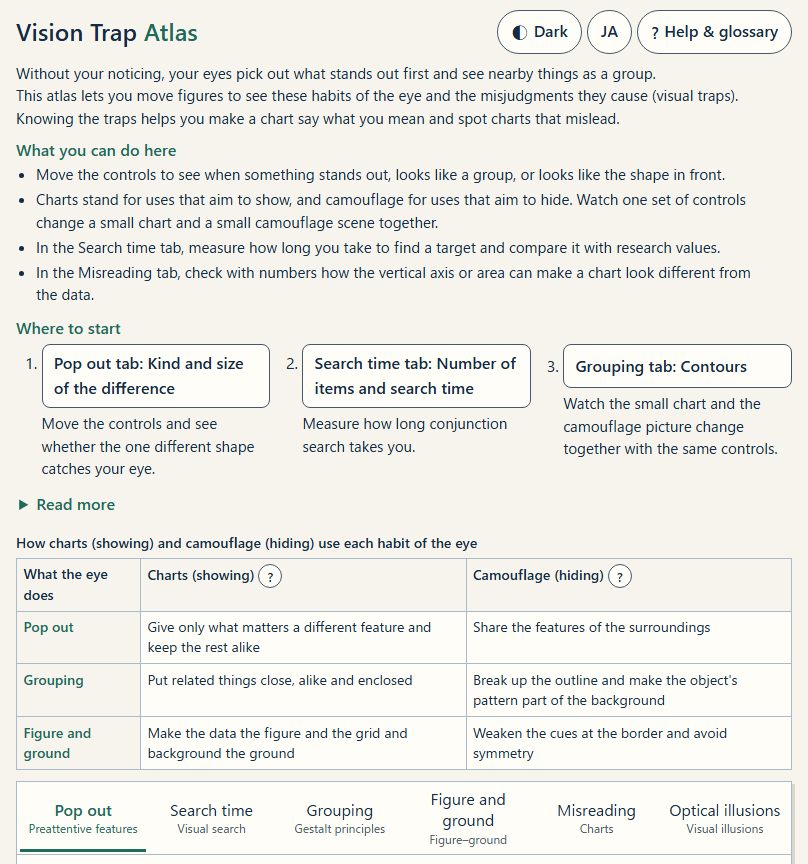
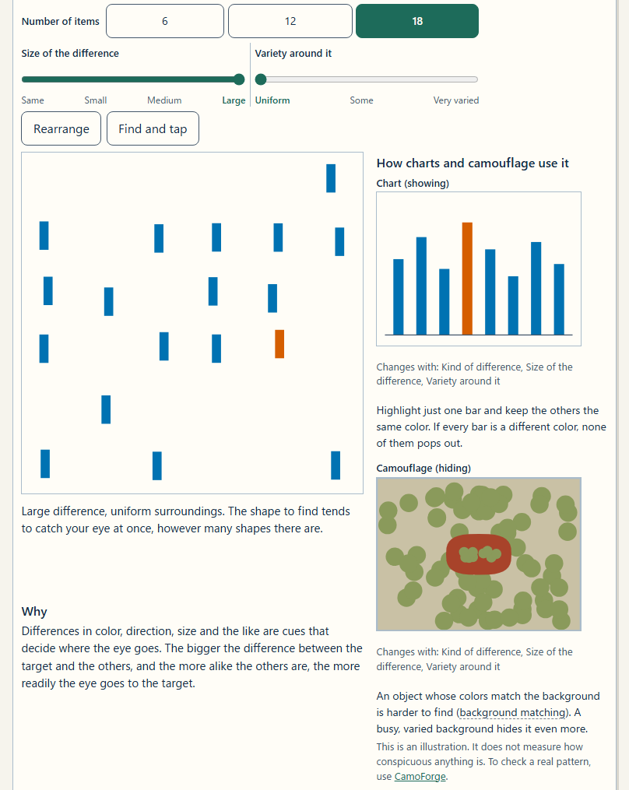
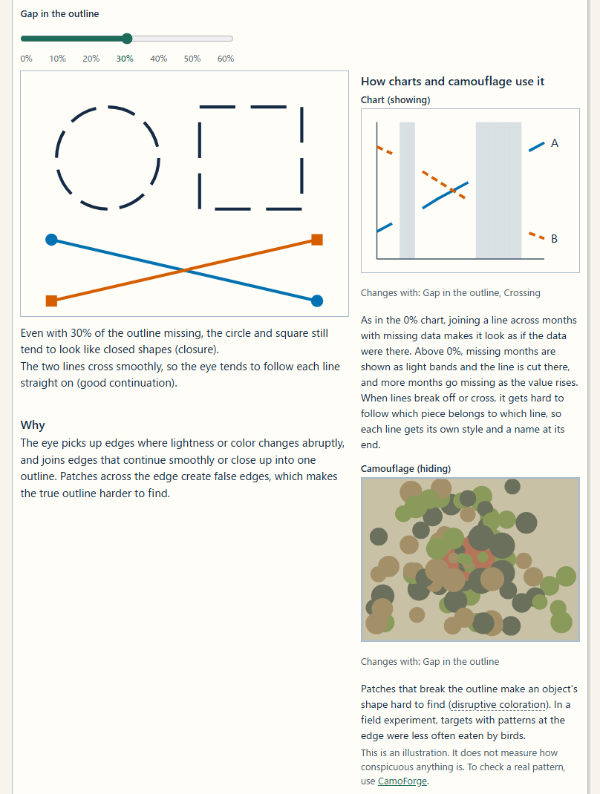
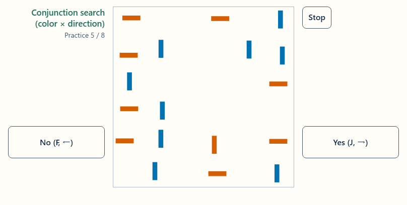
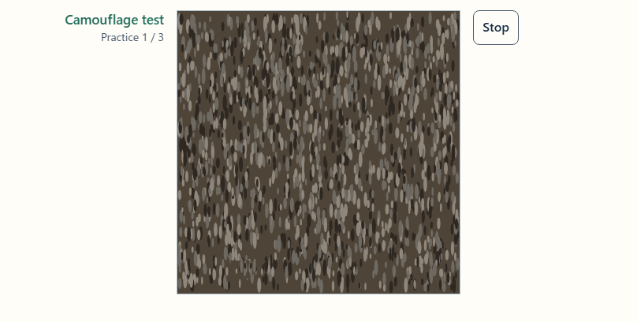
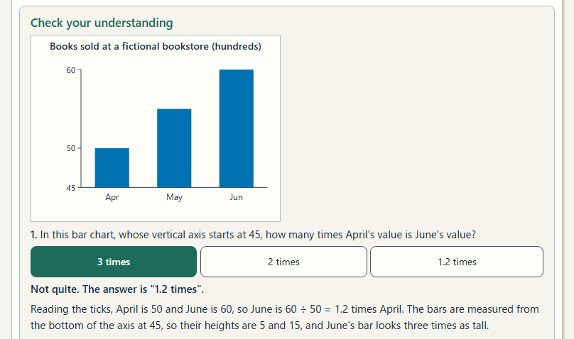

English · [日本語](README.md)

# Vision Trap Atlas - An atlas of visual traps to see and try

[](https://github.com/ipusiron/vision-trap-atlas/stargazers)
[](https://github.com/ipusiron/vision-trap-atlas/forks)
[](https://github.com/ipusiron/vision-trap-atlas/commits)
[](LICENSE)
[](https://ipusiron.github.io/vision-trap-atlas/)

**Day128 - 200 Security Tools with Generative AI**

Vision Trap Atlas is an atlas for checking what your eyes do before you think about it (noticing what stands out, seeing nearby things as a group, and so on) and the misjudgments that follow (visual traps), with figures you adjust and experiments that time your own search. It has 15 entries in 6 tabs: Pop out, Search time, Grouping, Figure and ground, Misreading and Optical illusions. Every entry works the same way: first pick an answer in "Predict before you try", then check it with the controls (or, in the experiment entries, with the test), and finally read "Why". In most entries, small figures show side by side how the same trait of the eye is used by charts to show and by camouflage to hide. Moving the controls of the main figure changes both small figures together. In our searches, we found no other teaching material that does this. It runs in a browser with nothing to install, for anything from school lessons to making charts and slides at work.

This is a learning atlas. Experiment records exist only on this page and are neither saved nor sent.

## 🌐 Demo

👉 **[https://ipusiron.github.io/vision-trap-atlas/](https://ipusiron.github.io/vision-trap-atlas/)**

Try it directly in your browser. It also works if you download the repository and open `index.html` through `file://`; no build or installation is needed. No account is needed either. Once the repository is downloaded, it works in a classroom without an internet connection: just open `index.html`.

The three buttons at the right end of the header switch light and dark ("Dark" or "Light"), switch the language ("JA"; on the Japanese screen the button shows "EN"), and open help and the glossary ("Help & glossary"). The language is chosen from `?lang=ja` or `?lang=en` in the URL, then a saved choice, then the browser language, in that order. The theme follows the OS setting unless a choice has been saved. Each is saved only when its button is pressed.

The tab shown goes into the URL after `#` (`#search` and so on). Opening the page with a tab id or an entry id after `#` (see the table in "📐 Screen layout") moves to that tab or entry. After the button to the next tab, or a button that moves to an entry in another tab, the browser's back button returns to where you were.

Until the page is ready, it shows the notice "Loading figures and controls" and keeps the controls disabled. With JavaScript disabled, the introduction and the contrast table can still be read (in Japanese), and the "Reopen in a new tab" link remains.

## 📸 Screenshots

These screenshots show the English screen in light mode. Switch to dark mode with "Dark" at the right end of the header, and to the Japanese screen with the "JA" button. Images of the Japanese screen are in [README.md](README.md).



> *Right after opening: the three sentences of the introduction, the four items of "What you can do here", the three buttons of "Where to start", the table contrasting charts (showing) with camouflage (hiding), and the six tabs.*



> *Pop out tab: "Kind and size of the difference" at its defaults (Kind of difference: Color; Size of the difference: Large; Variety around it: Uniform; Number of items: 18). The one bar of a different color among 18 bars catches the eye, and the small chart and the small camouflage scene on the right change with the same controls.*



> *Grouping tab: "Contours" with "Gap in the outline" at 30%. The circle and the square still look like closed shapes, the line of the small chart breaks at the 4 missing months, and 12 spots sit on the edge of the object in the small camouflage scene.*



> *Search time tab, search experiment: one display of the conjunction search practice (color × direction). There are 18 items, and one bar to find differs from the others only in its combination of color and direction. You answer with the buttons on both sides (No = F, ←; Yes = J, →) or with the keys.*



> *Search time tab, camouflage test: the display of the first practice round. A moth shape (a triangle with its base at the top) is hidden in a bark-like pattern. When you find it, you tap where it is.*



> *Misreading tab: "3 times" chosen in the first question of "Check your understanding". In the bar chart whose vertical axis starts at 45, June's bar looks three times as tall as April's, but the ticks give a value ratio of 1.2, and the reason is shown.*

## ✨ Features

The atlas offers the same four things that its "What you can do here" list names:

- Move the controls to see when something stands out, looks like a group, or looks like the shape in front.
- Charts stand for uses that aim to show, and camouflage for uses that aim to hide. Watch one set of controls change a small chart and a small camouflage scene together.
- In the Search time tab, measure how long you take to find a target and compare it with research values.
- In the Misreading tab, check with numbers how the vertical axis or area can make a chart look different from the data.

| Feature | What it does |
| --- | --- |
| 6 tabs and 15 entries | Pop out 3, Search time 2, Grouping 3, Figure and ground 2, Misreading 4, Optical illusions 1. The list and the ids are in the table of "📐 Screen layout" |
| Small chart and camouflage figures | In 9 entries, moving the controls of the main figure also changes a small chart (showing) and a small camouflage scene (hiding). A line under each small figure names the controls that change it. The 2 entries of the Search time tab have one of the two small figures, and the 4 entries of the Misreading tab have an easier-to-read form instead |
| Predict before you try, and Why | In all 15 entries. "Predict before you try" is a closed box with one question, 2 to 3 choices, and the answer with an explanation |
| Check your understanding | 2 questions at the end of each of the 6 tabs, 12 in all. Each applies what you saw to a figure other than those of the cards, and a choice shows at once whether it is right and why. No score is kept, and nothing is saved |
| Find and tap | In 2 entries of the Pop out tab. Tap the board to show the figure; the time until you tap the shape to find is measured once. After 10 seconds, "Show the answer" appears |
| Search experiment | Measures feature search and conjunction search with 3, 6, 12 and 18 items. A run has 8 practice tries and 32 recorded tries and takes about a minute and a half. The results are a chart of the number of items against time, a table, sentences, and a table of research values (Treisman & Gelade 1980; Wolfe 1998). The feature pair is "Color × direction" or "Fill × direction", which uses no color |
| Camouflage test | Compares the time to find a moth shape with three patterns: background-matching, breaking up the outline, and symmetric. A run has 3 practice rounds and 15 recorded rounds, with a limit of 10 seconds per round (about 4 minutes at most). The results are a chart of the middle value for each pattern, a table, sentences, and what studies have found |
| Motion | "Moving things stand out" moves for 3 seconds only after "Play" and then stops; "Stop" stops it at any time. With reduced motion, "Next frame" steps through 4 still frames |
| Checks and clues | "Checks when reading a chart" (4 of them) at the end of the Misreading tab, and "Clues for spotting camouflage" (2 of them) at the end of the Figure and ground tab. A button on each line moves to its entry |
| Help and glossary | The help (If this is your first visit, Controls, About this atlas) and 38 terms grouped by tab. Tapping a word with a dashed underline, or the "?" beside a table heading, shows its explanation in place |
| Japanese and English, light and dark | Switches the language and the theme. Only these two preferences are saved |

## 📖 How to use

This follows the same order as "If this is your first visit" in the help. First, move the controls in "Kind and size of the difference" in the Pop out tab. Next, in the Search time tab, measure how long conjunction search takes you. Finally, in "Contours" in the Grouping tab, watch the small chart and the small camouflage scene change together. The three buttons of "Where to start", shown right after opening, move to these entries in this order.

1. Press the first button of "Where to start" (Pop out tab: Kind and size of the difference). The Pop out tab opens, and the page moves to that entry.
2. Open "Predict before you try" under how to use the entry, and choose one answer. "Show the answer" shows the right choice and why. Choosing again hides the answer.
3. Move the sliders "Size of the difference" and "Variety around it", and switch "Kind of difference" and "Number of items". The figure, the sentence under it, and the small chart and camouflage scene on the right (below, on screens narrower than 720px) change together. The line "Changes with: …" under each small figure names the controls that change it.
4. Press "Find and tap", and the board "Tap here to start" covers the figure. Tap the board, and the figure appears and the timing starts; tap the one different shape, and the time appears under the sentence. A wrong shape is marked together with the shape to find. If nothing is found after 10 seconds, "Show the answer" appears. When "Find and tap" is chosen with the keyboard, it points to the experiment in the Search time tab.
5. In "Number of items and search time" in the Search time tab, choose the feature pair ("Color × direction" or "Fill × direction (no color)"), then press "Measure feature search" and "Measure conjunction search" once each. The test opens over the whole screen. Press "Start", and when the display appears after the fixation point (+), answer whether the bar to find is there (Yes = J, → or the right button; No = F, ← or the left button). After 8 practice tries, "Continue" moves on to the 32 recorded tries. "Stop" or Esc ends the run and shows the results so far.
6. The results show a chart of the number of items against time, a table, sentences and a table of research values. They exist only on this page; "Clear results" or a reload removes them.
7. In "Time to find a camouflaged object" in the same tab, press "Start the camouflage test", find the moth shape hidden in the bark-like pattern, and tap where it is (with a keyboard, choose a spot with the arrow keys and press Enter or Space). After 3 practice rounds come 15 recorded rounds, and the results show a chart and a table of the times for each pattern.
8. In "Contours" in the Grouping tab, move "Gap in the outline" from 0% to 30%, and watch the small chart and the small camouflage scene change together.
9. In "Check your understanding" at the end of each tab, answer questions that apply what you saw to other figures. A choice shows at once whether it is right and why. In every tab but the last, "Next tab" below moves to the next tab.
10. "Help & glossary" in the header opens the help and the glossary. A word with a dashed underline, or a "?", shows its explanation in place when tapped. The explanation also appears when the mouse rests on the word or the keyboard focus moves to it, and Esc hides it.

## 📐 Screen layout

| Place | What it holds |
| --- | --- |
| Header | The title and the three buttons at the right end (the theme, "Dark" or "Light"; the language, "JA" or "EN"; and "Help & glossary") |
| Introduction | The three sentences on the purpose, "What you can do here" (4 items), "Where to start" (3 buttons), "Read more" (the order of the tabs and what charts and camouflage do; closed at first), and the table contrasting charts (showing) with camouflage (hiding) |
| Tabs | 6. From 720px wide, all 6 in one row; below 720px, 3 in the upper row and 3 in the lower row |
| Footer | One link to GitHub (ipusiron/vision-trap-atlas) |

The 6 tabs and 15 entries are listed below. Opening the page with a tab id or an entry id after `#` in the URL moves to that tab or entry (for example, `https://ipusiron.github.io/vision-trap-atlas/#gestalt-contour`). This is useful for linking to an entry from other tools or materials.

| Tab (tab id) | Entry | Entry id |
| --- | --- | --- |
| Pop out (`popout`) | Kind and size of the difference (pop-out) | `popout-feature` |
| Pop out (`popout`) | An added line pops out; a missing line does not (search asymmetry) | `popout-asymmetry` |
| Pop out (`popout`) | Moving things stand out (motion) | `popout-motion` |
| Search time (`search`) | Number of items and search time (visual search) | `search-time` |
| Search time (`search`) | Time to find a camouflaged object (background matching, disruptive coloration) | `search-camo` |
| Grouping (`gestalt`) | Proximity and similarity | `gestalt-proximity-similarity` |
| Grouping (`gestalt`) | Enclosure and lines (common region, element connectedness) | `gestalt-region-connection` |
| Grouping (`gestalt`) | Contours (closure, good continuation) | `gestalt-contour` |
| Figure and ground (`figure-ground`) | The smaller, enclosed region becomes the figure (figure and ground) | `figure-ground-area` |
| Figure and ground (`figure-ground`) | Symmetry and convexity (figure and ground) | `figure-ground-symmetry` |
| Misreading (`misread`) | Where the vertical axis starts (truncated axis) | `misread-baseline` |
| Misreading (`misread`) | Showing amounts as areas (ordering of elementary perceptual tasks) | `misread-area` |
| Misreading (`misread`) | Two vertical axes (dual axis) | `misread-dual-axis` |
| Misreading (`misread`) | Aspect ratio and time range | `misread-aspect-range` |
| Optical illusions (`illusion`) | Lightness that changes with the surroundings (lightness contrast) | `illusion-lightness-contrast` |

Each tab holds, from top to bottom:

- The panel heading (the name of the tab and its technical term) and, in the Misreading tab only, the lead of the tab
- The buttons of "Entries in this tab" (only in tabs with two or more entries; each moves to its entry)
- The entry cards (in tabs with two or more entries, each card ends with "▲ Back to this tab's entries")
- The boxes at the end of the tab ("Clues for spotting camouflage" in the Figure and ground tab, "Checks when reading a chart" in the Misreading tab, and "Check your understanding" in every tab)
- The button to the next tab (not in the last tab, Optical illusions)

Each entry card holds, from top to bottom:

- The title (with a dashed underline under its technical terms), the one-line description and how to use the entry
- Predict before you try (a closed box)
- The switches and sliders (with "Rearrange" and "Find and tap" in the 2 entries of the Pop out tab, and with "Play" and "Stop" in "Moving things stand out")
- The main figure and how to read it (in the 4 entries of the Misreading tab, with the line of numbers under the figure and what to check when reading)
- Why
- How charts and camouflage use it (the small figures, the controls that change each, and the sentences under them)
- Where charts and camouflage do not match (some entries only)
- Sources and related tools (a closed box)

The 2 entries of the Search time tab have "Measure" (the start buttons and the length of a run) and "Results" in place of a main figure. The tests run over the whole screen. In the search experiment, the answer buttons stand on both sides of the square figure on a landscape screen and below it on a portrait screen; in the camouflage test, you answer by tapping a spot on the figure.

| Part | 720px wide or more | Narrower than 720px |
| --- | --- | --- |
| Entry card | The main figure, how to read it and Why on the left (about 60%), the small figures on the right (about 40%). From 1000px, the sentence of each small figure stands beside it | The main figure, how to read it, the small figures and Why, stacked in this order |
| Results tables of the experiments | One table | Split into two tables (never a table that scrolls sideways) |
| Figures A and B of a question | Side by side | One above the other |
| Where to start | Three side by side | Three one above the other |

## 🔬 Technical notes

`atlas-core.js` holds the calculations, `atlas-data.js` the data, `atlas-view.js` the shapes of the figures and the choice of the reading sentences, `atlas-search.js` the progress of the experiments and the motion, and `messages.js` the Japanese and English dictionaries. Each is a classic script in UMD form that does not depend on the DOM, so Node.js can load it with `require` (the tests load them this way). Only `app.js` handles the DOM. The scripts are not ES modules so that the page also works when opened through `file://`. Switching the language or the theme only draws the page again; it changes neither the results of the experiments nor the arrangement of the figures.

### The search experiment

- Number of items: 3, 6, 12 and 18. A square 360 units wide is split into a 6 × 6 grid, and the items are placed in cells that do not overlap (each center shifted by up to ±15% of a cell)
- Tries: for each number of items, with and without the bar to find, 1 practice try and 4 recorded tries. That makes 8 practice tries and 32 recorded tries, mixed with a seeded random number generator
- One try: fixation point 500 ms → display (up to 4,000 ms) → result line 500 ms → pause 300 ms
- Time-out: with no answer after 4,000 ms, the try counts as timed out and the next one begins
- Too early: a press during the fixation point, or less than 200 ms after the display appears, is not counted, and the same try goes once to the end of the block. A try during which the page is hidden is handled the same way
- Middle value: for each number of items, with and without the bar, the middle value of the correct answers (200 ms or more and under 4,000 ms). It is given only when 3 or more valid tries remain
- Slope: when 3 or more numbers of items have a middle value, the slope of the least-squares line through the numbers of items and the middle values (ms per item). The ratio of the absent slope to the present slope is given only when the present slope, rounded to one decimal, is 1 ms or more
- Timing: the display starts at the time of the `requestAnimationFrame` after the frame that made it visible, and the press is `event.timeStamp`, both on the same clock as `performance.now()`. Before each block, the timer resolution is measured, and a note appears in browsers that round times to 5 ms or more
- Wrong answers: answering "No" when the bar is there, or "Yes" when it is not, counts toward accuracy, and such tries are not used for the middle values or the slopes. They are not repeated

### How the result sentences are chosen

The result sentences are chosen with the widths below. They choose a sentence; they are not a test of significance.

- Difference of the absent slopes (conjunction search − feature search, rounded to one decimal): 15 ms or more gives "conjunction search had a slope … larger", more than −15 and under 15 gives "similar slopes", and −15 or less gives "feature search had the larger slope"
- Wrong answers: more than 10% of the answered tries (too early and timed-out tries aside) gives the sentence on wrong answers

15 ms is one unit of the estimated spread of the difference between two slopes. The estimate is a guess that assumes a spread (standard deviation) of reaction times of 200 ms. The middle value of 4 tries then spreads by about 1.25 × 200 ÷ √4 = 125 ms, the slope from 3, 6, 12 and 18 items by about 125 ÷ √132.75 ≈ 10.8 ms (132.75 is the sum of the squared differences between the numbers of items and their mean), and the difference of two slopes by about 10.8 × √2 ≈ 15.3 ms. So even with no real difference, about 1 run in 6 gives the sentence that conjunction search had the larger slope. The differences of the absent slopes in research (67.1 − 25.1 = 42.0 ms in Treisman & Gelade 1980, and about 27 − about 6 = about 21 ms in Wolfe 1998) are larger than 15 ms. The 10% for wrong answers comes from Wolfe 1998, whose error rates were almost always under 10%.

### The camouflage test

- Scene: a square 360 units wide is split into a 6 × 6 grid of spots (the grid is not drawn), and a moth shape is placed at the center of one cell. The moth shape is an isosceles triangle with its base at the top, 80% of a cell wide, with a width to height ratio of 2 to 1
- Background: a bark-like pattern drawn again for each round with a seeded random number generator: 1,800 tall oval patches in four brown and gray colors
- The three patterns: the background-matching pattern is 12 patches made the same way as the background and clipped by the triangle. The pattern that breaks up the outline moves 4 of them onto the edge of the triangle and paints them alternately in the darkest and lightest bark colors. The symmetric pattern copies the left-hand half to the right across the vertical center line. All three have the same number of patches (12) and the same total area
- Rounds: for each pattern, 1 practice round (not counted) and 5 recorded rounds. That makes 3 practice rounds and 15 recorded rounds, mixed with a seeded random number generator, never with the same cell twice in a row
- One round: fixation point 0.5 s → pattern (up to 10 s) → the line after a press (0.5 s after a correct or too early press; after a wrong spot or a time-out, the moth shape is marked and shown for 1 s) → pause 0.3 s
- Too early: a press under 200 ms, or a round during which the page is hidden, is not counted, and the same round goes once to the end of the block
- Valid round: a tap on the right spot after at least 0.2 s and within 10 s. A middle value is given only for patterns with 3 or more valid rounds
- Result sentences: the pattern that breaks up the outline and the symmetric pattern are each compared with the background-matching pattern. When the difference (after rounding to 0.1 s) is smaller than 20% of the middle value of the background-matching pattern, the sentence says there was no clear difference. The 20% chooses a sentence; whether your result matches the studies is not judged
- The limit of 10 seconds per round was chosen by looking at the studies (5 seconds per image in Fraser et al. (2007), and average search times of 2 to 10 seconds per target in Webster et al. (2013)); the studies themselves did not set it

### Formulas of the misreading entries

- Value ratio: maximum ÷ minimum. With the fictional loans of "Where the vertical axis starts" (52, 55 and 58 hundred books), 58 ÷ 52 ≈ 1.12
- Height ratio above the bottom: (maximum − bottom) ÷ (minimum − bottom). With the bottom of the vertical axis at 40, it is 1.50; at 50, it is 4.00
- Area ratio: "Stretch the height only" and "Match the area to the value ratio" give the value ratio (the height of the latter is the square root of the value ratio), and "Stretch both ways" gives the square of the value ratio
- Times the two lines cross: each month's temperature and rain are turned into 0 to 1 on their own axes, and the crossings are the times the sign of their difference changes between neighboring months (months with a difference of 0 are not counted). With the top of the right axis at 200, 300, 400 and 600 mm, the lines cross 2, 3, 0 and 0 times
- Average slope of the line: the mean of the absolute angles of the line segments (degrees). The aspect ratio is the width ÷ height of the plotting area, and the vertical axis runs from the minimum to the maximum value widened to multiples of 10. Over 24 months, aspect ratios of 0.5, 1, 2 and 4 give 67.3, 51.4, 33.5 and 19.0 degrees

### Data shape and adding entries

`atlas-data.js` holds the groups (tabs), the entries, the controls, how the small figures are bound to the controls, the questions, the fictional data, the sources, the related tools and the colors of the figures. Each entry has an id, a group, switches and sliders, how its main figure is drawn, its small figures (four sides: showing, hiding, easier to read, and reading), sources, related tools and safety marks (motion, stripes, flashing, and whether it relies on color alone); the texts on the screen are looked up in `messages.js` by keys such as `item.<id>.title`. `validateData` throws on duplicate ids, unknown groups or kinds of figure, unknown sources, flashing, motion longer than 5 seconds and the like. Adding a group and its entries adds a tab. A test uses data with one more group and one entry that has motion stopping within 5 seconds, fine stripes shown only after "Show", and a small figure for reading (`test/fixtures/illusion-data.js`), and checks that there are then seven tabs and that the entry gets its notice and the buttons to play, step to the next frame, stop and show.

### Random numbers

`Math.random` is not used. The arrangement of the figures and the order of the tries come from a seeded random number generator (xorshift32). The same seed gives the same arrangement, so the tests can check the coordinates of the figures and the order of the tries (`Math.random` cannot be seeded). `crypto.getRandomValues` is used only to make a new seed ("Rearrange", "Find and tap", and the start of an experiment). The seed is not for security; it only makes each arrangement different.

## 🎯 Use cases

Ways of using this tool in particular

1. Comparing emphasis and camouflage with the same controls (art, design and biology classes): in "Contours" in the Grouping tab, move "Gap in the outline" from 0% to 30%. The circle and the square in the main figure still look like closed shapes, the line of the small chart breaks at the 4 missing months, and 12 spots sit on the edge of the object in the small camouflage scene. Discuss how the same trait helps a chart show its data honestly and helps camouflage keep an object from being found.
2. Checking the slopes from research with your own search times (psychology and computing classes): in "Number of items and search time" in the Search time tab, measure feature search and conjunction search once each (8 practice tries and 32 recorded tries, about a minute and a half each), and compare your absent slopes with those of Treisman & Gelade 1980: 25.1 ms for feature search and 67.1 ms for conjunction search (per item). Do not compare the heights of the lines, which change with the device.
3. Practice before reading the charts of a meeting (work): in "Two vertical axes" in the Misreading tab, see how changing only "Top of the right axis" to 200, 300, 400 and 600 mm changes the number of times the two lines cross to 2, 3, 0 and 0, and then check the axis ranges of the charts in your own documents.
4. Saying with numbers why a small difference looks large (news charts, classes): in "Where the vertical axis starts" in the Misreading tab, a bar chart with a value ratio of 1.12 looks like a height ratio of 4.00 when the bottom of the vertical axis is 50. Discuss it together with the experiment in which a broken-axis mark did not remove the sense of a larger difference (Correll et al. (2020)).
5. Making the same 24 months look steep or flat (people who write reports): in "Aspect ratio and time range" in the Misreading tab, set the time range to "24 months" and change the aspect ratio from 0.5 to 4, and the average slope of the line goes from 67.3 to 19.0 degrees. With the time range at "Last 6 months", a rise from 4,000 to 5,200 books looks like a fall from 6,000 to 5,200 books.
6. Choosing emphasis that does not rely on color (people who make slides): in "Kind and size of the difference" in the Pop out tab, switch "Kind of difference" from "Color" to "Direction" or "Size". With "Size of the difference" at "Large", the difference is 90 degrees in direction and 2 times in size, so you can check whether the one different shape catches the eye whatever one's color vision (Day101 covers color vision in more detail).

### Using it in class

"Predict before you try", found in every entry, follows one flow: choose a prediction, check it with the controls or the test, then read the reason in "Why". Prediction–observation–explanation (POE) is one of the methods that science education uses to probe understanding, and White & Gunstone (1992), Probing Understanding, has a chapter on it. "Check your understanding" at the end of each tab applies what you saw to figures other than those of the cards, so it suits the end of a lesson. No account is needed, and once the repository is downloaded, it works in a classroom without an internet connection by opening `index.html`.

#### A 20-minute session

This is an example of a 20-minute session in which a teacher shows one screen to the class. Before the lesson, open the page and set a zoom level at which the figures and the text can be read.

| Time | Screen and actions | What to check |
| --- | --- | --- |
| 0–3 min | Read "What you can do here" right after opening, and press the first button of "Where to start" | That visual traps are misjudgments that come from what the eye does before we think |
| 3–8 min | In "Kind and size of the difference" in the Pop out tab, open "Predict before you try" and have everyone choose a prediction. Move "Variety around it" from "Uniform" to "Very varied", and read the answer and why with "Show the answer" | That the one different shape stands out less when the colors around it vary. That in the small chart on the right, the highlighted bar also stands out less |
| 8–13 min | In "Contours" in the Grouping tab, move "Gap in the outline" from 0% to 30% | That the circle and the square still look closed, while the line of the small chart breaks at the missing months and more spots sit on the edge in the small camouflage scene. That the same trait is used by charts to show and by camouflage to hide |
| 13–18 min | In "Where the vertical axis starts" in the Misreading tab, move "Bottom of the vertical axis" to 0, 40 and 50, and read the line of numbers under the figure | That the value ratio stays at 1.12 while the height ratio above the bottom changes to 1.12, 1.50 and 4.00 |
| 18–20 min | Answer the first question of "Check your understanding" at the end of the Misreading tab | That the value ratio read from the ticks and the ratio of the bar heights can be told apart |

#### A 45-minute session

This is an example of a 45-minute session in which students use one device each or work in pairs. The search experiment is easier to compare when everyone measures on the same kind of device.

| Time | Screen and actions | What to check |
| --- | --- | --- |
| 0–5 min | Read "What you can do here" and the table contrasting charts (showing) with camouflage (hiding) | That the showing side and the hiding side use the same trait of the eye for opposite ends |
| 5–12 min | In "Kind and size of the difference" in the Pop out tab, choose a prediction, then move "Variety around it" and "Kind of difference" (Color, Direction, Size) | That the one different shape stands out more when the others are alike. That differences in direction or size can make it stand out besides color |
| 12–22 min | In "Number of items and search time" in the Search time tab, choose a prediction, then measure feature search and conjunction search once each (about a minute and a half each) | Whether the absent slope of conjunction search came out larger than that of feature search. That only slopes and ratios are compared with research values |
| 22–32 min | In "Proximity and similarity" and "Contours" in the Grouping tab, and in "The smaller, enclosed region becomes the figure" in the Figure and ground tab, choose a prediction before moving the controls. Answer "Check your understanding" in the Figure and ground tab | That the small chart and the small camouflage scene change together with the same controls |
| 32–40 min | Go through the 4 entries of the Misreading tab, read "Checks when reading a chart" at the end, and answer the 2 questions of "Check your understanding" | That the bottom of the vertical axis, areas, two vertical axes, and the aspect ratio and time range can be checked with numbers |
| 40–45 min | Choose one of the "Discussion questions" below and discuss it | That the uses on the showing side and the hiding side can be explained in one's own words |

#### Discussion questions

| Number | Question | Where to check |
| --- | --- | --- |
| 1 | To make one bar of a chart stand out, what can you change besides color? Which of these stands out for people whose color vision differs? | "Kind of difference" (Direction, Size, Lightness) in "Kind and size of the difference" in the Pop out tab |
| 2 | If you made a camouflage pattern, what pattern would you put on the edge of the object, and why? | The small camouflage scene and "Why" in "Contours" in the Grouping tab |
| 3 | When the vertical axis of a news chart does not start at 0, what should you check? | "Where the vertical axis starts" and "Checks when reading a chart" in the Misreading tab |

#### Talking about the search experiment results

- The height of the lines (the overall speed) changes with the device, the screen and the way of answering, so do not compare it between people. Compare only the slopes (the time added per item) and the ratio of the absent slope to the present slope.
- Set your slopes beside the research values (for conjunction search in Treisman & Gelade 1980, 28.7 ms when the target was present and 67.1 ms when it was absent, and so on), and see whether the slopes of conjunction search came out larger than those of feature search.
- Results of 32 tries by one person are noisy. The width that chooses the result sentence (15 ms) is exceeded in about 1 run in 6 even with no real difference. Setting the slopes of several people in the class side by side shows how large that noise is.
- Do not judge fast or slow as good or bad. What you are studying is a trait of the eye, not a person's ability.

### Ideas for a junior high school research project

Here are five themes for a junior high school research project, such as a summer project or a science fair entry. Each theme changes one thing and compares the results of several people, such as family members and friends.

#### 1. How does the time to find a target change as more items appear?

In "Number of items and search time" in the "Search time" tab, measure two kinds of search once each: "feature search", where one feature such as color is enough to find the target, and "conjunction search", where only a combination of two features such as color and direction tells it apart. Each takes about a minute and a half. Ask family members or friends to do the same on the same device with the same feature pair, then make a table of the middle value (median) for 3, 6, 12 and 18 items and the slope (the time added per item). If anyone finds the colors hard to tell apart, set everyone's feature pair to "Fill × direction". Compare the slopes with the research values shown in the results (Treisman & Gelade 1980; Wolfe 1998). Checking whether the slope differs by age broadens the theme.

#### 2. Which pattern makes an object hardest to find?

"Time to find a camouflaged object" in the "Search time" tab has you find a moth shape hidden on a bark-like background, and compares the time it takes with three patterns: a background-matching pattern, a pattern that breaks up the outline, and a symmetric pattern. It takes about 4 minutes at most per person. Ask several people to try it, then make a table of the middle value for each pattern and the number of rounds in which the shape was not found within 10 seconds. Compare the results with "What studies have found", and think about the reasons for any difference. Observing the patterns of insects and birds around you and sorting them by which of the three patterns they resemble links the theme to biology.

#### 3. How different does the same gray look on different surrounds?

In "Lightness that changes with the surroundings" in the "Optical illusions" tab, the two squares stay the same gray and only their surrounds change. Show family members the figure at each of the five steps of "Difference between the surrounds" (0, 25, 50, 75 and 100%), ask "Which square looks lighter, the left or the right, or do they look the same?", and count the answers at each step. Setting "Compare" to "Joined by a band" and asking again shows whether the answers change. Placing gray paper on white paper and on black paper lets you check whether the same thing happens off the screen.

#### 4. Which decides the grouping: spacing or shape?

In "Proximity and similarity" in the "Grouping" tab, set "Similarity" to "Shapes vary by row". Then change "Dot spacing" from "Even" to "Tight down" and "Very tight down": the shapes group the dots into rows, while the spacing groups them into columns. At each step, ask "Do the dots look like rows or columns?", and record for each person the step at which the answer changes to columns.

#### 5. How much bigger does an increase look when the vertical axis does not start at 0?

"Where the vertical axis starts" in the "Misreading" tab shows a bar chart of loans at a fictional library (52 in April, 55 in May and 58 in June, in hundreds of books). The values stay the same, and only the bottom of the vertical axis changes. Show family members the chart with the bottom at 0, 30 and 50, and ask them to rate how much the loans seem to have grown from April to June on a five-point scale (1 = hardly changed, 5 = grew a lot). Put the answers in a table next to the "Height ratio above the bottom" shown below the chart. You can also check whether turning on "Axis-break mark" changes the answers. Collecting charts from newspapers and flyers and counting how many start the vertical axis at 0 turns the theme into a survey of everyday charts.

#### Tips for any theme

- Write down your prediction before you start. You can use the answer you chose in "Predict before you try" for each item as your prediction.
- Change only one thing. Keep the device, screen brightness, distance from the screen and way of answering (keys or touch) the same.
- Before you start, tell the people who help you what they will do, how long it takes, and that they can stop at any time. Do not write their names in your notes; use labels such as A and B, and record their age group only if you need it.
- Do not rate anyone's speed or answers as good or bad. You are studying how people tend to see things, not how able they are.
- When you show a figure and ask a question, cover the text and numbers below the figure with paper, and show the figures in a different order to each person.
- Results are not saved and disappear when you reload the page. Write them down or take a screenshot right after you measure.
- A result that differs from the studies is not a failure. List how your test differs from theirs, such as the number of people, the screen size and the amount of practice, and think about the reasons.

### Using it with CamoForge

[CamoForge](https://ipusiron.github.io/camoforge/) (Day085) generates camouflage patterns, lays them over background photos, and scores how well they blend into the background (0 to 100) and which cues would give them away. This tool does not measure how conspicuous anything is, so first see how the eye works in this tool's figures, then use CamoForge to check whether the same thing happens with a camouflage pattern on a photo background.

The numbers below were measured with CamoForge's built-in color presets and backgrounds only, with Scale, Contrast, Brightness and Overlay opacity left at their defaults (60, 1.00, -0.20 and 0.70). Pressing "Regenerate" redraws the pattern and can change the numbers by 1 or 2.

#### Blend scores that change with the background

1. In the Optical illusions tab, open "Lightness that changes with the surroundings" and move "Difference between the surrounds". In the small camouflage scene, the object's lightness stays matched to the left background while only the right background gets lighter.
2. In CamoForge's "Generate" tab, keep "Pattern type" at "Military-style (noise)" and set the color preset to "Woodland BDU" under Military camouflage.
3. Go to the "Environment check" tab. In the table under the environment presets, "Blend score of this pattern (by background, photo and generated)", compare the photo bars by background. Then select the Snow photo and look at "Color match" and "Brightness" in the "Blend score" panel.
4. With the Snow photo still selected, press "Extract colors from the image" to rebuild the pattern from the snow photo's colors, then check the table again.

| Pattern colors | Grass | Soil | Server room | Cable bundle | Forest path | Snow |
| --- | --- | --- | --- | --- | --- | --- |
| Woodland BDU | 97 | 95 | 86 | 85 | 82 | 49 |
| Colors extracted from the snow photo | 55 | 50 | 50 | 53 | 59 | 95 |

The numbers are the blend scores on the photo bars of the table. With Woodland BDU and the Snow photo selected, the "Blend score" panel showed "Color match" 35 and "Brightness" 39 (96 and 97 on the Grass photo).

The same pattern blends very differently depending on the background. When the pattern that scored 49 on snow is rebuilt from the snow photo's colors, it rises to 95 on snow and drops to the 50s on grass and soil. In this tool's small scene, matching the object's lightness to the left background leaves a visible edge against the right one. In CamoForge too, a pattern matched to one background scores lower on the others.

#### What changes with color vision

1. In the Pop out tab, open "Kind and size of the difference" and switch "Kind of difference" between "Color" and "Lightness". Either way, the one different shape tends to catch your eye right away.
2. In CamoForge, use the same "Woodland BDU" pattern as above and select the Snow photo in the "Environment check" tab. Switch "Color vision simulation" and watch "Brightness" in the "Blend score" panel.
3. In the "Generate" tab, set "Pattern type" to "Digital camo (pixel)" and the color preset to "NWU Type I Blueberries" under Digital camouflage. Select the Grass photo in the "Environment check" tab, switch the simulation the same way, and watch "Color match".

| Color vision simulation | Snow photo with Woodland BDU (Brightness) | Grass photo with NWU Type I Blueberries (Color match) |
| --- | --- | --- |
| Normal vision | 39 | 85 |
| Protanopia (red-blind) | 42 | 89 |
| Deuteranopia (green-blind) | 43 | 90 |
| Tritanopia (blue-blind) | 33 | 90 |
| Monochrome (achromatopsia) | 39 | 100 |

For Woodland BDU on the Snow photo, "Brightness" stays low, between 33 and 43, in every simulation. For NWU Type I Blueberries on the Grass photo, normal vision gives "Brightness" 99 but "Color match" only 85, and in monochrome the color match also reaches 100. A lightness difference remains whatever the viewer's color vision, while a color difference can shrink or disappear. Whether you highlight one bar in a chart or judge how easily camouflage is spotted, check color differences and lightness differences separately.

Note that the Grass photo with NWU Type I Blueberries shows clear blue squares in the preview, yet its overall blend score comes out high, around 92. The total compares averages over the whole image, so check the breakdown for cues that would give a pattern away.

#### Straight lines the blend score does not show

1. In the Pop out tab, open "An added line pops out; a missing line does not" and set "Shape to find" to "Circle with a line". In the small camouflage scene, a straight line is added to the object.
2. In CamoForge's "Generate" tab, set "Pattern type" to "Custom noise" and the color preset to "Panel — Olive Drab Industrial" under Hardware panels.
3. In the "Environment check" tab, select the Soil photo, turn on "Detect view (heatmap of where it stands out)", and set "Cue to view" to "Straight lines (man-made edges)".
4. Change "Pattern type" to "Hardware panel (grid)", select the same color preset again, and compare the blend score and the "Lines" score.

| Pattern type (Soil photo) | Blend score | Lines |
| --- | --- | --- |
| Custom noise | 88 | 3 |
| Hardware panel (grid) | 92 | 42 |

In color, brightness and contrast, the panel pattern is close to the soil, and its blend score comes out higher than the noise pattern's. Even so, the heatmap shows the square panel edges in red, and the "Lines" score rises from 3 to 42. The blend score is computed only from differences in color, brightness and contrast, so check edges the background lacks, such as straight lines, in the cue breakdown. The caption of this tool's small scene says that a feature the background lacks, such as a straight line, makes an object easy to spot; in CamoForge, that shows up as the "Lines" score.

### Other ways of using it

- Education: science and art teachers move the size of the difference and the variety around it in "Kind and size of the difference" in the Pop out tab to open a lesson. In computing and math classes, the Misreading tab covers how to read statistical charts.
- Work: a UI designer uses "An added line pops out; a missing line does not" in the Pop out tab to decide whether to add or remove a notification mark (an added mark catches the eye; a mark that is only removed hardly does). People who make documents use "Checks when reading a chart" to review a chart before showing it.
- Daily life: people who see charts in the news or in ads check the bottom of the vertical axis, areas, two vertical axes and the time range.
- Hobbies and creative work: people who paint camouflage on models, draw, or hide things in games check the ideas of background matching and of patterns that break up the outline with "Contours" in the Grouping tab and "Time to find a camouflaged object". How well a real pattern blends into its background is measured in CamoForge.
- A first step into research: students beginning psychology learn the form of a reaction-time experiment (fixation point, practice, recorded tries, handling of too early presses, middle values and slopes). It is not for research measurements.
- Combinations: color differences, contrast ratios and color illusions in Day101 Color Hack Box; real camouflage patterns in Day085 CamoForge; visual cryptography, where black and gray in two stacked sheets are read as letters, in Day070 VisualCryptography CipherLab; CAPTCHAs, whose distorted letters are read through closure and good continuation, in Day075 CAPTCHA Art Generator; and reading by stacking, where stacked white becomes 50% gray and the contrast is halved, in Day125 Overlay QR Shares.

### Limits

- The search experiment gives 32 tries and the camouflage test 15 rounds per person, so the results are noisy.
- Times change with the device, the size and brightness of the screen, the viewing distance and the way of answering (keys or touch). Compare only slopes and ratios, and differences between patterns.
- The visual angle cannot be fixed, so do not compare the numbers directly with those of research.
- Wrong answers are not repeated, and the tries right after a wrong answer are not dropped.
- The small chart and camouflage figures are illustrations; they do not measure how conspicuous anything is (CamoForge measures real patterns).
- The patterns of the camouflage test are not real bark or moths, and the test differs from field experiments in which birds searched.
- The values of the charts in the Misreading tab are fictional.

## 🔒 Security

- The CSP is `default-src 'none'; script-src 'self'; style-src 'self'; img-src 'self' data:; base-uri 'none'; form-action 'none'; frame-src 'none'; object-src 'none'; connect-src 'none'` (set by a meta element in `index.html`).
- No referrer is sent (`<meta name="referrer" content="no-referrer">`).
- There are no text fields. The only `<input>` is the slider (`type="range"`), and neither `<textarea>` nor `contenteditable` is used.
- Only the language and the theme are saved (localStorage keys `vision-trap-atlas.language` and `vision-trap-atlas.theme`). Nothing is saved on the first visit; each is saved only when its button is pressed.
- The records of the experiments, the predictions and the answers to the questions live only in variables of the page, and are neither saved nor sent. A reload clears them.
- There is no network access (no `fetch`, `XMLHttpRequest` or WebSocket, and the CSP's `connect-src 'none'` blocks it as well). No external script, style or font is loaded.
- The text on the screen is built from elements and text nodes, without `innerHTML`. The SVG figures are built with `createElementNS` and `setAttribute`, without `style` attributes.
- Links to other sites (the DOIs of the sources, the related tools and GitHub) are plain links (`target="_blank" rel="noopener noreferrer"`) that open in a new tab without `window.open` and without relying on JavaScript.
- Random numbers come from a seeded generator (xorshift32), not `Math.random`, with `crypto.getRandomValues` used only to make the seed (see "Random numbers" in "🔬 Technical notes").

Loading the published page and opening source links involve normal network requests. The tool has no feature that sends anything you enter, and there are no input fields.

## ⚠️ Notes and limits

**The search experiment and the camouflage test are experiences for learning, not research measurements.** Their results are values from a small number of tries by one person on one device.

- Nothing flashes or moves on its own. Only "Moving things stand out" moves, and only after "Play": it stops after 3 seconds, and "Stop" stops it at any time. With reduced motion, "Next frame" steps through 4 still frames. CSS `transition` and `animation` are not used.
- Every figure that relies on color differences has a switch that avoids color ("Kind and size of the difference" has Direction and Size, and the search experiment has "Fill × direction"). Text has a contrast ratio of at least 4.5:1 with its background, and the lines and shapes of the figures at least 3:1.
- Times change with the device, the size and brightness of the screen, the viewing distance and the way of answering (keys or touch). The research values in the results are a reference for comparing slopes and ratios.
- The visual angle cannot be fixed, so do not compare the numbers directly with those of research.
- Wrong answers are not repeated, and the tries right after a wrong answer are not dropped (Treisman & Gelade 1980 repeated wrong tries later and did not record the try right after a wrong answer).
- The small chart and camouflage figures are illustrations; they do not measure how conspicuous anything is. To check a real pattern, use CamoForge.
- The values of the charts in the Misreading tab and in the questions are fictional.
- The two experiments cannot be done with a screen reader (the results tables can be read aloud).
- The browsers checked are Chromium 145, Firefox 146 and WebKit 26.0 of Playwright on Windows. WebKit is not Safari itself.

Not in this atlas (ideas for the future)

- Saving results (such as CSV) and printing
- More illusions (the Ebbinghaus illusion, the Müller-Lyer illusion and others)
- More misreadings (3D pie charts, an upside-down vertical axis, cumulative charts, log axes without ticks)
- An experiment that changes how often the target appears

## 🔗 References

Earlier work and what this atlas adds are shown in the table below.

| Earlier work (within the searches) | What it has | What this atlas adds |
| --- | --- | --- |
| [Healey, "Perception in Visualization"](https://www.csc2.ncsu.edu/faculty/healey/PP/index.html) | A table of preattentive features, theories, applications to visualization, and a search demo whose display time and number of items are set with sliders. It does not record times. No Gestalt principles, misleading charts or Japanese | Measuring your own search times beside the slopes from research, small camouflage (hiding) figures, Japanese and English |
| [Michael Bach, "Optical Illusions & Visual Phenomena"](https://michaelbach.de/ot/) | An interactive collection of 156 illusions and visual phenomena (with pop-out and Gestalt categories). It does not measure times. English and German | Small chart and camouflage figures moved with the same controls, measuring search times, misleading charts, Japanese |
| [PsyToolkit visual search](https://www.psytoolkit.org/experiment-library/search.html) | An experiment looking for a target set apart by a combination. It records reaction times | A chart of the number of items against time made on the spot, set beside research values |
| [jsPsych visual-search-circle](https://www.jspsych.org/latest/plugins/visual-search-circle/) | A plugin for building visual search experiments (MIT) | Measuring by just opening the page, without building an experiment, with a chart and sentences of the results |
| [Kisoji Online](https://kohske.github.io/KisojiOnline/) | Japanese exercises in psychology experiments (visual search, the Müller-Lyer illusion and others). Results come as raw data or CSV; making charts is left to the teacher | A chart and result sentences on the spot, research values, showing and hiding figures |
| [Hanover ISLE](https://isle.hanover.edu/isle2/Ch05Object/Ch05ProxSim_evt.html) | Sliders for proximity and similarity, and sliders for the lightness and contrast of Rubin's vase | Small chart and camouflage figures that change with the same controls, Japanese |
| [Calling Bullshit, "Spotting misleading axes"](https://callingbullshit.org/tools/tools_misleading_axes.html) | An explanation of misleading axes (truncation, dual axes and others), with still images and text | Moving them with controls and giving ratios and crossings as numbers |
| [React Graph Gallery, "The Problem with Dual Y-Axes"](https://www.react-graph-gallery.com/example/dual-y-axis-interactive) | A demo that changes the ranges of the left and right axes with sliders | Giving the crossings as a number, and placing it in one atlas with the other misreadings and the habits of the eye |
| [Zero baseline explainer](https://vpascual.github.io/explainer-zeroaxis) | A demo that switches between bars and a line and moves the bottom of the vertical axis | Giving the height ratio above the bottom as a number, and the axis-break mark |
| [Project Nightjar](https://thentrythis.org/projects/project-nightjar/) | Citizen science that collected the time to find camouflaged birds and eggs in games | Setting it beside the showing side (charts), comparing times by kind of pattern, Japanese and English in a browser |
| [CamoEvo](https://pmc.ncbi.nlm.nih.gov/articles/PMC9314924/) | An ImageJ tool that evolves camouflage patterns from the times people take to find them | No installation, and the contrast with the showing side |
| [TU Graz, "Dishonest Chart Techniques"](https://courses.isds.tugraz.at/ivis/surveys/ss2026/ivis-ss2026-g2-survey-dishonest-chart-techniques.pdf) | Demos that build 9 kinds of misleading chart with sliders and switches (2026). No preattentive features, Gestalt principles or figure and ground. English | Placing misleading charts in one atlas with preattentive features, Gestalt principles and figure and ground, Japanese |
| [FlowingData, "Defense Against Dishonest Charts"](https://flowingdata.com/projects/dishonest-charts/) | An interactive guide that goes through the parts of a chart, how small changes alter its look, the kinds of misleading chart, and how to read the data (2025) | Likewise, placing it in one atlas with the habits of the eye, Japanese |

No teaching material that lets you experience the same visual traits from both the showing side (data visualization) and the hiding side (camouflage), sets your own search times beside the slopes from research, and covers misleading charts as well, in one atlas in Japanese and English, was found in web searches on 2026-11-12 (main search terms: camouflage and data visualization "same" perceptual principles salience highlight hide teaching, Project Nightjar game find the camouflaged bird search time citizen science, PsyToolkit visual search experiment library online, Healey perception in visualization preattentive processing demo, interactive Gestalt principles demo proximity similarity closure explorable, interactive misleading chart playground slider y-axis baseline aspect ratio explorable, and two Japanese queries for visual search pop-out demos and interactive Gestalt principles). Explanations of preattentive features, search time experiments, Gestalt controls, controls for misleading charts and camouflage search games each have earlier work, as the table shows. What this atlas adds is their combination.

The references (the sources listed under "Sources and related tools" on the screen) are as follows.

- Adelson, E. H. (2000). Lightness perception and lightness illusions. In M. Gazzaniga (Ed.), The New Cognitive Neurosciences (2nd ed., pp. 339–351). MIT Press.
- Anwyl-Irvine, A., et al. (2021). Realistic precision and accuracy of online experiment platforms, web browsers, and devices. Behavior Research Methods, 53(4), 1407–1425. DOI [10.3758/s13428-020-01501-5](https://doi.org/10.3758/s13428-020-01501-5)
- Cleveland, W. S. (1993). Visualizing Data. Hobart Press.
- Cleveland, W. S., & McGill, R. (1984). Graphical perception: Theory, experimentation, and application to the development of graphical methods. Journal of the American Statistical Association, 79(387), 531–554. DOI [10.1080/01621459.1984.10478080](https://doi.org/10.1080/01621459.1984.10478080)
- Cleveland, W. S., McGill, M. E., & McGill, R. (1988). The shape parameter of a two-variable graph. Journal of the American Statistical Association, 83(402), 289–300. DOI [10.1080/01621459.1988.10478598](https://doi.org/10.1080/01621459.1988.10478598)
- Correll, M., Bertini, E., & Franconeri, S. (2020). Truncating the y-axis: Threat or menace? Proceedings of CHI 2020, 1–12. DOI [10.1145/3313831.3376222](https://doi.org/10.1145/3313831.3376222)
- Cuthill, I. C., Hiby, E., & Lloyd, E. (2006). The predation costs of symmetrical cryptic coloration. Proceedings of the Royal Society B, 273, 1267–1271. DOI [10.1098/rspb.2005.3438](https://doi.org/10.1098/rspb.2005.3438)
- Cuthill, I. C., Stevens, M., Sheppard, J., Maddocks, T., Párraga, C. A., & Troscianko, T. S. (2005). Disruptive coloration and background pattern matching. Nature, 434(7029), 72–74. DOI [10.1038/nature03312](https://doi.org/10.1038/nature03312)
- Fowlkes, C. C., Martin, D. R., & Malik, J. (2007). Local figure–ground cues are valid for natural images. Journal of Vision, 7(8), 2. DOI [10.1167/7.8.2](https://doi.org/10.1167/7.8.2)
- Fraser, S., Callahan, A., Klassen, D., & Sherratt, T. N. (2007). Empirical tests of the role of disruptive coloration in reducing detectability. Proceedings of the Royal Society B, 274(1615), 1325–1331. DOI [10.1098/rspb.2007.0153](https://doi.org/10.1098/rspb.2007.0153)
- Hall, J. R., Cuthill, I. C., Baddeley, R., Shohet, A. J., & Scott-Samuel, N. E. (2013). Camouflage, detection and identification of moving targets. Proceedings of the Royal Society B, 280(1758), 20130064. DOI [10.1098/rspb.2013.0064](https://doi.org/10.1098/rspb.2013.0064)
- Healey, C. G., & Enns, J. T. (2012). Attention and visual memory in visualization and computer graphics. IEEE Transactions on Visualization and Computer Graphics, 18(7), 1170–1188. DOI [10.1109/TVCG.2011.127](https://doi.org/10.1109/TVCG.2011.127)
- Heer, J., & Agrawala, M. (2006). Multi-scale banking to 45 degrees. IEEE Transactions on Visualization and Computer Graphics, 12(5), 701–708. DOI [10.1109/TVCG.2006.163](https://doi.org/10.1109/TVCG.2006.163)
- Heer, J., & Bostock, M. (2010). Crowdsourcing graphical perception: Using Mechanical Turk to assess visualization design. Proceedings of CHI 2010, 203–212. DOI [10.1145/1753326.1753357](https://doi.org/10.1145/1753326.1753357)
- Lo, L. Y.-H., Gupta, A., Shigyo, K., Wu, A., Bertini, E., & Qu, H. (2022). Misinformed by visualization: What do we learn from misinformative visualizations? Computer Graphics Forum, 41(3), 515–525. DOI [10.1111/cgf.14559](https://doi.org/10.1111/cgf.14559)
- Merilaita, S., Scott-Samuel, N. E., & Cuthill, I. C. (2017). How camouflage works. Philosophical Transactions of the Royal Society B, 372(1724), 20160341. DOI [10.1098/rstb.2016.0341](https://doi.org/10.1098/rstb.2016.0341)
- Mittelstädt, S., Stoffel, A., & Keim, D. A. (2014). Methods for compensating contrast effects in information visualization. Computer Graphics Forum, 33(3), 231–240. DOI [10.1111/cgf.12379](https://doi.org/10.1111/cgf.12379)
- Muth, L. C. (2018). Why not to use two axes, and what to use instead. Datawrapper Blog. [Datawrapper](https://www.datawrapper.de/blog/dualaxis)
- Palmer, S. E. (1992). Common region: A new principle of perceptual grouping. Cognitive Psychology, 24(3), 436–447. DOI [10.1016/0010-0285(92)90014-S](https://doi.org/10.1016/0010-0285(92)90014-S)
- Palmer, S., & Rock, I. (1994). Rethinking perceptual organization: The role of uniform connectedness. Psychonomic Bulletin & Review, 1(1), 29–55. DOI [10.3758/BF03200760](https://doi.org/10.3758/BF03200760)
- Pandey, A. V., Rall, K., Satterthwaite, M. L., Nov, O., & Bertini, E. (2015). How deceptive are deceptive visualizations?: An empirical analysis of common distortion techniques. Proceedings of CHI 2015, 1469–1478. DOI [10.1145/2702123.2702608](https://doi.org/10.1145/2702123.2702608)
- Ratcliff, R. (1993). Methods for dealing with reaction time outliers. Psychological Bulletin, 114(3), 510–532. DOI [10.1037/0033-2909.114.3.510](https://doi.org/10.1037/0033-2909.114.3.510)
- Rubin, E. (1915). Synsoplevede Figurer: Studier i psykologisk Analyse. Gyldendalske Boghandel, Nordisk Forlag.
- Stevens, M., & Cuthill, I. C. (2006). Disruptive coloration, crypsis and edge detection in early visual processing. Proceedings of the Royal Society B, 273(1598), 2141–2147. DOI [10.1098/rspb.2006.3556](https://doi.org/10.1098/rspb.2006.3556)
- Stevens, M., & Merilaita, S. (2009). Defining disruptive coloration and distinguishing its functions. Philosophical Transactions of the Royal Society B, 364(1516), 481–488. DOI [10.1098/rstb.2008.0216](https://doi.org/10.1098/rstb.2008.0216)
- Talbot, J., Gerth, J., & Hanrahan, P. (2012). An empirical model of slope ratio comparisons. IEEE Transactions on Visualization and Computer Graphics, 18(12), 2613–2620. DOI [10.1109/TVCG.2012.196](https://doi.org/10.1109/TVCG.2012.196)
- Treisman, A. M., & Gelade, G. (1980). A feature-integration theory of attention. Cognitive Psychology, 12(1), 97–136. DOI [10.1016/0010-0285(80)90005-5](https://doi.org/10.1016/0010-0285(80)90005-5)
- Treisman, A., & Souther, J. (1985). Search asymmetry: A diagnostic for preattentive processing of separable features. Journal of Experimental Psychology: General, 114(3), 285–310. DOI [10.1037/0096-3445.114.3.285](https://doi.org/10.1037/0096-3445.114.3.285)
- Wagemans, J., Elder, J. H., Kubovy, M., Palmer, S. E., Peterson, M. A., Singh, M., & von der Heydt, R. (2012). A century of Gestalt psychology in visual perception: I. Perceptual grouping and figure–ground organization. Psychological Bulletin, 138(6), 1172–1217. DOI [10.1037/a0029333](https://doi.org/10.1037/a0029333)
- Webster, R. J., Hassall, C., Herdman, C. M., Godin, J.-G. J., & Sherratt, T. N. (2013). Disruptive camouflage impairs object recognition. Biology Letters, 9(6), 20130501. DOI [10.1098/rsbl.2013.0501](https://doi.org/10.1098/rsbl.2013.0501)
- Wertheimer, M. (1923). Untersuchungen zur Lehre von der Gestalt. II. Psychologische Forschung, 4(1), 301–350. English translation: Laws of organization in perceptual forms. In W. D. Ellis (Ed.), A source book of Gestalt psychology (pp. 71–88). Routledge & Kegan Paul, 1938. DOI [10.1007/BF00410640](https://doi.org/10.1007/BF00410640)
- Wolfe, J. M. (1994). Guided Search 2.0: A revised model of visual search. Psychonomic Bulletin & Review, 1(2), 202–238. DOI [10.3758/BF03200774](https://doi.org/10.3758/BF03200774)
- Wolfe, J. M. (1998). What can 1 million trials tell us about visual search? Psychological Science, 9(1), 33–39. DOI [10.1111/1467-9280.00006](https://doi.org/10.1111/1467-9280.00006)
- Wolfe, J. M. (2021). Guided Search 6.0: An updated model of visual search. Psychonomic Bulletin & Review, 28(4), 1060–1092. DOI [10.3758/s13423-020-01859-9](https://doi.org/10.3758/s13423-020-01859-9)
- Wolfe, J. M., & Horowitz, T. S. (2004). What attributes guide the deployment of visual attention and how do they do it? Nature Reviews Neuroscience, 5(6), 495–501. DOI [10.1038/nrn1411](https://doi.org/10.1038/nrn1411)
- Wolfe, J. M., & Horowitz, T. S. (2017). Five factors that guide attention in visual search. Nature Human Behaviour, 1(3), 0058. DOI [10.1038/s41562-017-0058](https://doi.org/10.1038/s41562-017-0058)
- Wolfe, J. M., Palmer, E. M., & Horowitz, T. S. (2010). Reaction time distributions constrain models of visual search. Vision Research, 50(14), 1304–1311. DOI [10.1016/j.visres.2009.11.002](https://doi.org/10.1016/j.visres.2009.11.002)

Cited in "Using it in class": White, R., & Gunstone, R. (1992). Probing Understanding. Falmer Press. DOI [10.4324/9780203761342](https://doi.org/10.4324/9780203761342) (the 2014 e-book edition)

To see more illusions, [Akiyoshi Kitaoka's illusion pages](https://www.psy.ritsumei.ac.jp/akitaoka/), the [NTT Illusion Forum](https://illusion-forum.ilab.ntt.co.jp/) and [The Illusions Index](https://www.illusionsindex.org/) are good places to start. Every figure of this atlas was drawn for it.

The related tools are as follows (the same as "Sources and related tools" on the screen).

| Tool | How it relates to this atlas |
| --- | --- |
| [Day101 Color Hack Box](https://ipusiron.github.io/color-hack-box/) | Color differences and contrast ratios are in the "Grayscale" tab; color vision diversity, design that does not rely on color alone, and color illusions are in the "Trivia" tab |
| [Day085 CamoForge](https://ipusiron.github.io/camoforge/) | Check how well a real pattern blends into its background (the "Environment check" tab) |
| [Day070 VisualCryptography CipherLab](https://ipusiron.github.io/visual-cryptography-cipherlab/) | The eye reads the difference between black and gray in two stacked sheets as letters (a figure) |
| [Day075 CAPTCHA Art Generator](https://ipusiron.github.io/captcha-art-generator/) | The eye reads distorted letters through closure and good continuation |
| [Day125 Overlay QR Shares](https://ipusiron.github.io/overlay-qr-shares/) | Read by stacking. Stacked white becomes 50% gray, so the contrast is halved |

## 🧪 Tests

The tests run on Node.js 22 or later, with no packages to install.

```sh
npm test
```

`npm test` runs `node --test "test/**/*.test.js"`. GitHub Actions (`.github/workflows/test.yml`) checks the syntax (`node --check`) and runs `npm test` on Node.js 22 for every push and pull request. The tests compute the numbers of the READMEs (the feature table, the technical notes, the ways of using this tool in particular, the screenshot captions and the class sessions) again with the calculation and the data.

| File | What it checks |
| --- | --- |
| `test/core.test.js` | Known values of the random number generator, the placement in the grid, the order of the tries, the classification of answers, middle values and slopes, the cases of the result sentences, the camouflage scene and its summary, color contrast, and the ratios of the misreading entries |
| `test/data.test.js` | The ids and order of the 15 entries, the rules of the data, the texts of the predictions and questions, the related tools, and the shape that takes another group |
| `test/view.test.js` | The shapes and sizes of the figures, the cases of the reading sentences, how the small figures follow the controls, and the results charts and tables |
| `test/search.test.js` | The progress of Find and tap, the search experiment, the camouflage test and the motion (with a fake clock: timing, too early presses, time-outs, stopping, and a hidden page) |
| `test/text.test.js` | Every case of the sentences that change with values, built with nothing left to fill in, the known sentences, and the words of the camouflage results |
| `test/structure.test.js` | The CSP, referrer, OGP (the six meta elements and the description, never rewritten by a script), script order, no network or storage beyond the two preferences, no input fields, no animation, link attributes, and no local paths or words about how the work went |
| `test/i18n.test.js` | The keys and placeholders of the two dictionaries, no Japanese in English values, no space between Japanese and Latin letters, the avoided words, and the 38 terms |
| `test/format.test.js` | Line lengths, no BOM, the lines of the main files, and package.json |
| `test/contrast.test.js` | Text contrast in light and dark (4.5:1 or more), and the contrast of the stimuli, the lines of the figures and the shapes of the small figures (3:1 or more) |
| `test/theme-init.test.js` | The theme set before drawing (the OS setting, a saved choice, a failed save) |
| `test/readme.test.js` | The README front matter, matching headings in both languages, the numbers computed again, the images (decodable PNG, 808px wide, 300,000 bytes or less), the directory tree against the real files, the avoided words, the list of entry ids, and the references and related tools |

The browser checks use Playwright for Python (Chromium, Firefox and WebKit). They are not part of CI.

```sh
python -X utf8 -B test/interface.browser.py --browser chromium
python -X utf8 -B test/startup.browser.py
```

- `test/interface.browser.py`: at widths of 320, 390, 720 and 1280px, in Japanese and English, light and dark, it checks that there is no console error or CSP violation, that the page never scrolls sideways, the tabs, every value of every control with the reading sentences and the sentences of the small figures, Find and tap and the two experiments (with Playwright's `clock` held, answers put in at chosen times, and the results tables and sentences compared with the values of the calculation), the predictions and questions, `#` in the URL and the back button, links opening in a new tab, the OGP unchanged after a language switch, and no Japanese left on the English screen. Without `--browser`, it runs the three browsers in turn.
- `test/startup.browser.py`: it checks the first view without saved preferences, and that with JavaScript delayed, missing or disabled, the explanations can be read and the controls are disabled. It also checks that the shared summary (OGP) is in the page even with JavaScript disabled.
- Both write their results to the folder given with `--output`. Without it, they write to a new folder in the OS temporary directory and write nothing inside the repository.

## 📁 Directory structure

```text
vision-trap-atlas/            # Root of the repository
|-- .gitattributes            # Keeps LF line ends (2 lines: * text=auto eol=lf, *.png binary)
|-- .github/                  # GitHub settings
|   `-- workflows/            # Automated test definitions
|       `-- test.yml          # Syntax check (node --check) and npm test on every push and pull_request (Node 22)
|-- LICENSE                   # MIT
|-- README.md                 # Japanese description (the front matter is here only)
|-- README.en.md              # English description (the same sections as README.md)
|-- index.html                # The page (CSP, OGP, startup)
|-- style.css                 # Design, light and dark colors, figure colors, layout on narrow screens
|-- theme-init.js             # Sets the theme before drawing (loaded synchronously)
|-- atlas-core.js             # Calculations (random numbers, placement, tries, middle values and slopes, camouflage scenes, misreading ratios; UMD, no DOM)
|-- atlas-data.js             # Groups, entries, controls, small-figure binding, questions, fictional data, sources, related tools, figure colors
|-- atlas-view.js             # Shapes of the figures and the choice of reading sentences (returns lists of shapes; no DOM)
|-- atlas-search.js           # Progress of Find and tap, the search experiment, the camouflage test and motion (clock given from outside; no DOM)
|-- messages.js               # Japanese and English dictionaries
|-- app.js                    # DOM and state
|-- package.json              # npm test definition (no dependencies)
|-- assets/                   # Screenshots for the READMEs (screenshot.png is also the image for sharing)
|   |-- screenshot.png        # Right after opening (introduction, where to start, contrast table, tabs)
|   |-- screenshot2.png       # Pop out, kind and size of the difference (defaults)
|   |-- screenshot3.png       # Grouping, contours (gap 30%)
|   |-- screenshot4.png       # Search experiment (conjunction search, 18 items)
|   |-- screenshot5.png       # Camouflage test (first practice round)
|   |-- screenshot6.png       # Misreading, a question with its answer
|   `-- en/                   # English screen
|       |-- screenshot.png    # Right after opening (English)
|       |-- screenshot2.png   # Pop out (English)
|       |-- screenshot3.png   # Grouping (English)
|       |-- screenshot4.png   # Search experiment (English)
|       |-- screenshot5.png   # Camouflage test (English)
|       `-- screenshot6.png   # A question (English)
`-- test/                     # Automated tests
    |-- core.test.js          # A (random numbers, placement, tries, classification, middle values and slopes, camouflage scenes, misreading ratios)
    |-- data.test.js          # B (list of ids, rules of the data, the shape that takes another group)
    |-- view.test.js          # C (shapes of the figures, cases of reading sentences, small-figure binding)
    |-- search.test.js        # D (progress of Find and tap, the experiments and motion, timing, cases of result sentences)
    |-- text.test.js          # E (sentences that change with values, placeholders)
    |-- structure.test.js     # F (CSP, OGP, script order, no sending or storing, no animation)
    |-- i18n.test.js          # F (keys of both languages, no Japanese in English, avoided words)
    |-- format.test.js        # F (line lengths, BOM, line counts)
    |-- contrast.test.js      # F (contrast of text, stimuli, and lines and shapes of the figures)
    |-- theme-init.test.js    # F (theme set before drawing)
    |-- readme.test.js        # G (front matter, matching headings, numbers computed again, images, tree)
    |-- fixtures/             # Small data for the tests
    |   `-- illusion-data.js  # B (data with one more group and entry)
    |-- interface.browser.py  # H (Playwright for Python; not in CI)
    `-- startup.browser.py    # H (first view without saved preferences; not in CI)
```

The letters at the start of the descriptions (A to H) are the kinds of check the tests make (A = calculations, B = data, C = shapes of the figures, D = progress of the experiments, E = sentences, F = static checks, G = READMEs, H = browser checks).

## 💻 Requirements

- Runs on HTML, CSS and classic JavaScript (UMD form) only. No build and no external libraries at run time.
- Open `index.html` in a browser. It works the same when downloaded and opened through `file://` and on GitHub Pages.
- The browsers checked are Chromium, Firefox and WebKit of Playwright on Windows. WebKit is not Safari itself.
- The page uses JavaScript, SVG and `<dialog>`, and saves only the language and the theme in localStorage.
- The tests need Node.js 22 or later (`npm test`). The browser checks need Python and Playwright (Chromium, Firefox and WebKit). Neither is needed for normal use.

## 📄 License

The source code is under the MIT License ([LICENSE](LICENSE); Copyright (c) 2026 ipusiron). No external library is loaded at run time. Every figure was drawn for this atlas; the works listed as references are subject to their own rights.

## 🛠️ About this tool

This tool was developed as part of the "200 Security Tools with Generative AI" project.
In this project, a wide range of security-related tools are built and published over 100 days with the help of AI.

For details of the project and the other tools, see the following page.

🔗 [https://akademeia.info/?page_id=44607](https://akademeia.info/?page_id=44607)

All tools in the series are listed on [Hacking Lab Online](https://hackinglab.online/).
