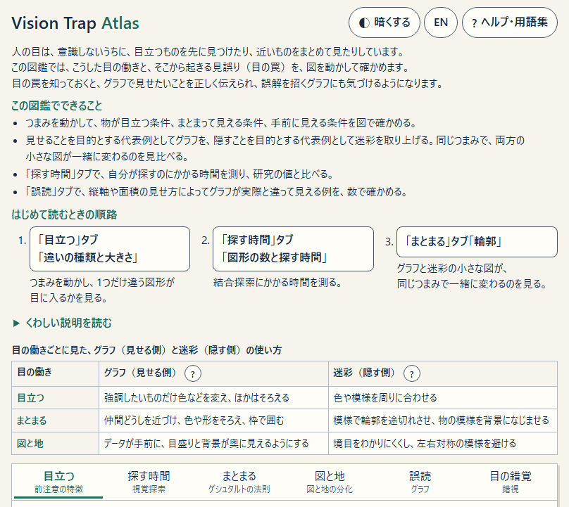
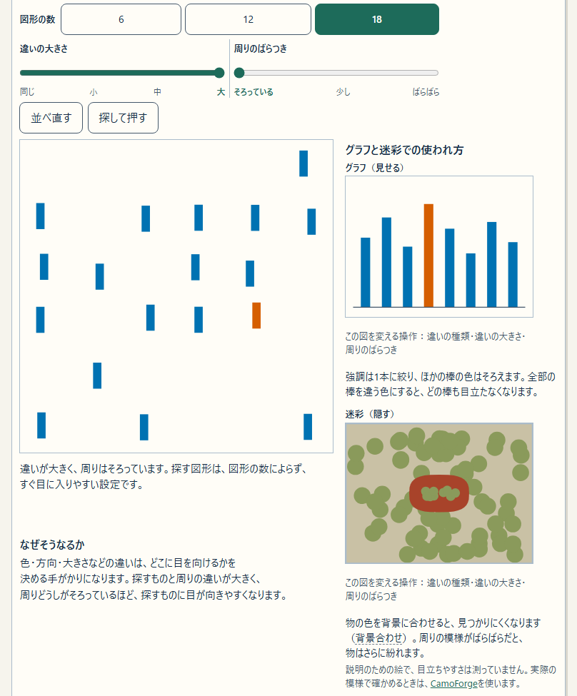
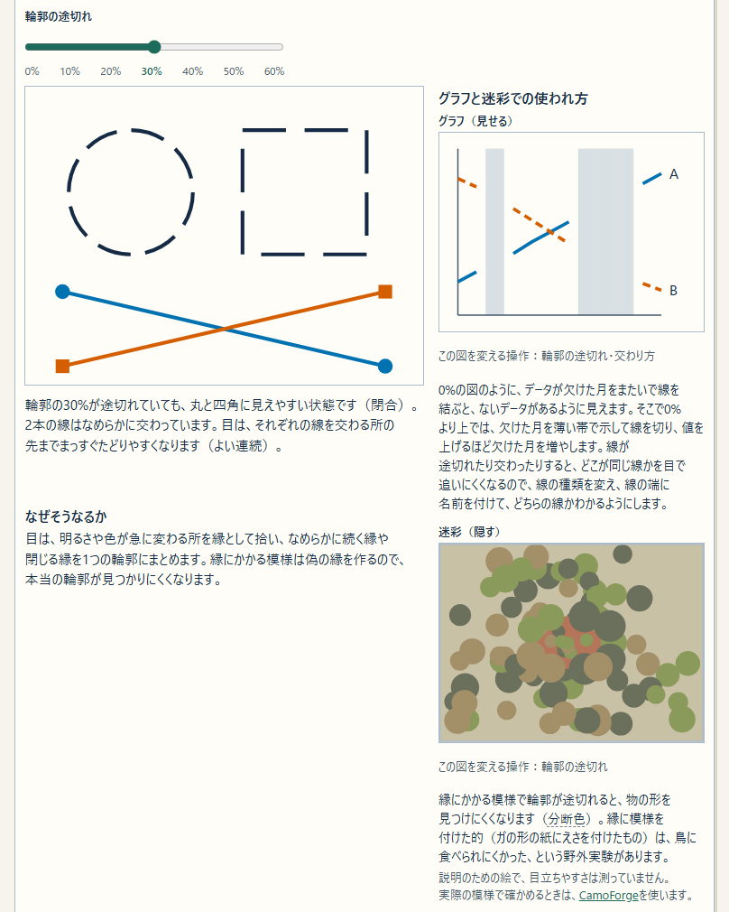
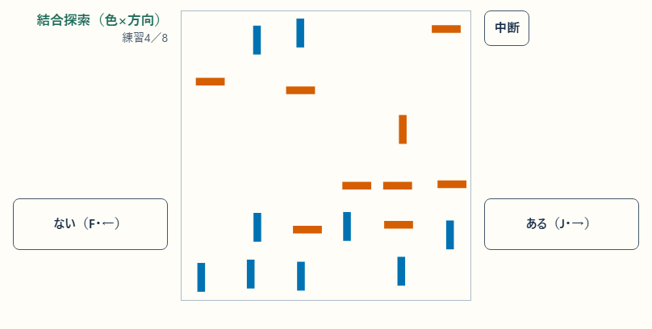
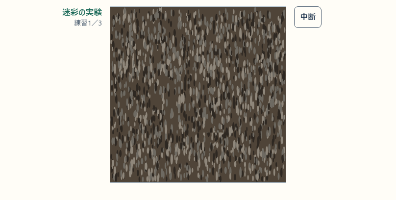
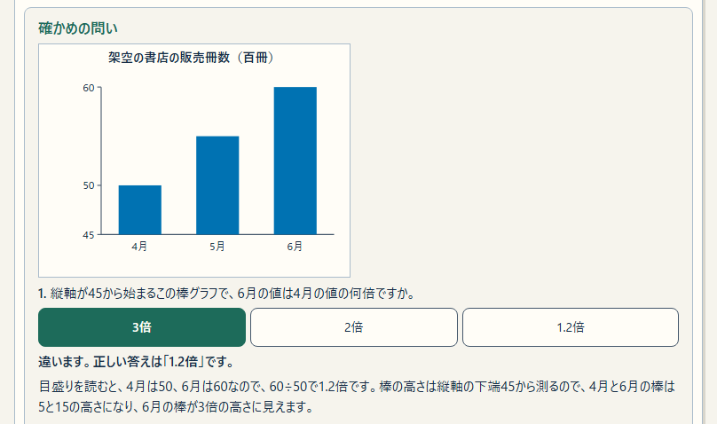

<!--
---
id: day128
slug: vision-trap-atlas

title: "Vision Trap Atlas"
subtitle_ja: "目の罠を見て、押して確かめる図鑑"
subtitle_en: "An atlas of visual traps to see and try"

description_ja: "人が意識するより先に目がしてしまうこと（ポップアウト・視覚探索・ゲシュタルトの法則・図と地・グラフの誤読・目の錯覚）を、つまみで動かす図と、自分の探す時間を測る2つの実験で確かめる図鑑。同じ目の性質が、グラフでは見せるために、迷彩では隠すために使われる様子を、小さな図で並べる。記録は画面の中だけで、外部へは何も送らない。日英対応。"
description_en: "An atlas for checking what your eyes do before you think about it (pop-out, visual search, Gestalt principles of grouping, figure and ground, chart misreading and optical illusions), with figures you adjust and two experiments that time your own search. Small figures show how the same traits are used by charts to show and by camouflage to hide. Records stay on the page; nothing is sent anywhere. Japanese and English UI."

category_ja:
  - 可視化
  - 学習支援
category_en:
  - Visualization
  - Learning Support

difficulty: 2

tags:
  - visual-perception
  - preattentive-features
  - visual-search
  - gestalt
  - gestalt-principles
  - figure-ground
  - misleading-charts
  - data-visualization
  - camouflage
  - optical-illusions
  - education

repo_url: "https://github.com/ipusiron/vision-trap-atlas"
demo_url: "https://ipusiron.github.io/vision-trap-atlas/"
hub: true
---
-->

# Vision Trap Atlas - 目の罠を見て、押して確かめる図鑑

[English](README.en.md) · 日本語

[](https://github.com/ipusiron/vision-trap-atlas/stargazers)
[](https://github.com/ipusiron/vision-trap-atlas/forks)
[](https://github.com/ipusiron/vision-trap-atlas/commits)
[](LICENSE)
[](https://ipusiron.github.io/vision-trap-atlas/)

**Day128 - 生成AIで作るセキュリティツール200**

Vision Trap Atlasは、人が意識するより先に目がしてしまうこと（目立つものに目が行く、近いものをまとめて見る、など）と、そこから起きる見誤り（目の罠）を、つまみで動かす図と、自分の探す時間を測る実験で確かめる図鑑です。「目立つ」「探す時間」「まとまる」「図と地」「誤読」「目の錯覚」の6つのタブに、15の項目があります。どの項目も、まず「動かす前に予想する」で答えを選び、つまみ（実験の項目では実験）で確かめ、最後に「なぜそうなるか」を読む、という順で使えます。多くの項目では、同じ目の性質が、グラフでは見せるために、迷彩では隠すために使われる様子を、小さな図で並べています。上の図のつまみを動かすと、2つの小さな図も一緒に変わります。この見せ方は、調べた範囲では、ほかの教材に見当たらない点です。中学校・高校の授業から、グラフやスライドを作る仕事まで、ブラウザーで開くだけで使えます。

学習用の図鑑です。実験の記録はこのページの中だけにあり、保存も送信もしません。

## 🌐 デモページ

👉 **[https://ipusiron.github.io/vision-trap-atlas/](https://ipusiron.github.io/vision-trap-atlas/)**

ブラウザーで直接お試しいただけます。リポジトリーをダウンロードして`index.html`を`file://`で開いても動き、ビルドもインストールも、アカウントも要りません。ダウンロードしておけば、ネットにつながらない教室でも`index.html`を開くだけで使えます。

見出しの右端にあるボタン3つは、明暗の切り替え（「暗くする」か「明るくする」）・言語の切り替え（「EN」。英語の画面では「JA」）・ヘルプと用語集（「ヘルプ・用語集」）です。言語は、URLの`?lang=ja`か`?lang=en`、保存した選択、ブラウザーの言語の順で決まります。明暗は、保存した選択がなければOSの設定に従います。どちらも、ボタンを押したときだけ保存します。

開いているタブは、URLの`#`の後ろ（`#search`など）に入ります。URLの`#`の後ろにタブのidか項目のid（「📐 画面構成」の表）を付けて開くと、そのタブか項目へ移ります。「次のタブへ」や、別のタブの項目へ移るボタンを押したあとは、ブラウザーの「戻る」で元の位置に戻れます。

準備ができるまでは「図と操作を準備中」の案内を出し、操作のボタンを押せないようにしています。JavaScriptが無効のときも、導入の文と対比の表を読むことができ、別タブで開き直すリンクも残ります。

## 📸 スクリーンショット

ライトモードの日本語の画面です。ダークモードは見出しの右端の「暗くする」、英語の画面は「EN」のボタンで切り替えます。英語の画面の画像は[README.en.md](README.en.md)に載せています。



> *開いた直後：導入の3文、「この図鑑でできること」の4項目、「はじめて読むときの順路」の3つのボタン、グラフ（見せる側）と迷彩（隠す側）の対比の表、6つのタブが並びます。*



> *「目立つ」タブ：「違いの種類と大きさ」を既定（違いの種類＝色、違いの大きさ＝大、周りのばらつき＝そろっている、図形の数＝18）のまま開いた画面です。18個の棒の中で1本だけ色が違う棒が目に入り、右のグラフと迷彩の小さな図は同じつまみで一緒に変わります。*



> *「まとまる」タブ：「輪郭」で「輪郭の途切れ」を30%にした画面です。丸と四角は閉じた形に見えたまま、グラフの小さな図では欠けた4か月で線が切れ、迷彩の小さな図では物の縁に12個の斑点が重なります。*



> *「探す時間」タブの探す実験：結合探索（色×方向）の練習の1画面です。図形は18個で、色と方向の組み合わせだけがほかと違う探す棒が1本あります。左右のボタン（ない＝F・←、ある＝J・→）かキーで答えます。*



> *「探す時間」タブの迷彩の実験：練習1回目の1画面です。樹皮のような模様の中に、蛾の形（底辺を上にした三角形）が1つ隠れています。見つけたら、その場所を押します。*



> *「誤読」タブ：「確かめの問い」の1問目で「3倍」を選んだ画面です。縦軸が45から始まる棒グラフでは、6月の棒が4月の棒の3倍の高さに見えますが、目盛りで読むと値の比は1.2倍で、その理由も出ます。*

## ✨ 機能

この図鑑でできることは、開いた直後の画面にある「この図鑑でできること」の4つです。

- つまみを動かして、物が目立つ条件、まとまって見える条件、手前に見える条件を図で確かめる。
- 見せることを目的とする代表例としてグラフを、隠すことを目的とする代表例として迷彩を取り上げる。同じつまみで、両方の小さな図が一緒に変わるのを見比べる。
- 「探す時間」タブで、自分が探すのにかかる時間を測り、研究の値と比べる。
- 「誤読」タブで、縦軸や面積の見せ方によってグラフが実際と違って見える例を、数で確かめる。

| 機能 | 内容 |
| --- | --- |
| 6つのタブと15の項目 | 「目立つ」3・「探す時間」2・「まとまる」3・「図と地」2・「誤読」4・「目の錯覚」1の項目。一覧とidは「📐 画面構成」の表 |
| グラフと迷彩の小さな図 | 9つの項目では、上の図のつまみを動かすと、グラフ（見せる側）と迷彩（隠す側）の小さな図も一緒に変わる。小さな図の下に、その図を変える操作の名前を出す。「探す時間」タブの2項目は片方の小さな図だけを置き、「誤読」タブの4項目は読みやすくした形の図を置く |
| 動かす前に予想する・なぜそうなるか | 15の項目すべてにある。「動かす前に予想する」は畳んだ箱で、問い1つと選択肢2〜3つ、答えと説明を持つ |
| 確かめの問い | 6つのタブの最後に2問ずつ、合わせて12問。カードとは別の図に当てはめて答え、選ぶとその場で正しいかどうかと説明が出る。点数は数えず、保存もしない |
| 探して押す | 「目立つ」タブの2項目にある。板を押して図を出し、探す図形を押すまでの時間を1回だけ測る。10秒たつと「答えを見る」が出る |
| 探す実験 | 特徴探索と結合探索を、図形の数3・6・12・18個で測る。練習8回と本番32回で、約1分半かかる。結果は、図形の数と時間のグラフ・表・文と、研究の値の表（Treisman & Gelade 1980、Wolfe 1998）。特徴の組は「色×方向」か、色を使わない「塗り×方向」 |
| 迷彩の実験 | 背景に合わせた模様・輪郭を途切れさせる模様・左右対称の模様の3つで、蛾の形を見つけるまでの時間を比べる。練習3回と本番15回で、1回の制限は10秒（長くても4分ほど）。結果は、模様ごとの真ん中の値のグラフ・表・文と、研究で知られていること |
| 動き | 「動くものは目立つ」は、「動かす」を押したときだけ3秒動いて止まり、「止める」でいつでも止まる。動きを減らす設定では、「次のコマ」で4コマの静止画を順に見る |
| 確かめ方と手がかり | 「誤読」タブの最後に「グラフを読むときの確かめ方」が4つ、「図と地」タブの最後に「迷彩を見破る手がかり」が2つある。各行のボタンで、その項目へ移る |
| ヘルプと用語集 | ヘルプ（はじめて読むとき・操作・この図鑑について）と、タブごとに分けた用語38語。画面の破線の下線の語と、表の見出しの「?」を押すと、その場に説明が出る |
| 日英・明暗 | 日本語と英語、ライトとダークを切り替える。保存するのは言語と明暗の2つだけ |

## 📖 使い方

ヘルプの「はじめて読むとき」と同じ順で進めます。まず「目立つ」タブの「違いの種類と大きさ」でつまみを動かします。次に「探す時間」タブで結合探索にかかる時間を測ります。最後に「まとまる」タブの「輪郭」で、グラフと迷彩の小さな図が一緒に変わるのを見ます。開いた直後の「はじめて読むときの順路」の3つのボタンを上から押すと、この順にそれぞれの項目へ移ります。

1. 「はじめて読むときの順路」の1つ目のボタン（「目立つ」タブ「違いの種類と大きさ」）を押す。「目立つ」タブが開き、その項目へ移る。
2. 項目の使い方の下にある「動かす前に予想する」を開き、選択肢を1つ選ぶ。「答えを見る」を押すと、正しい選択肢と説明が出る。選び直すと、答えはまた隠れる。
3. 「違いの大きさ」「周りのばらつき」のつまみと、「違いの種類」「図形の数」の切り替えを動かす。上の図、その下の見方の文、右（幅720px未満では下）のグラフと迷彩の小さな図が一緒に変わる。小さな図の下の「この図を変える操作：…」に、その図を変える操作の名前が出る。
4. 「探して押す」を押すと、図の上に「ここを押すと始まります」の板が出る。板を押すと図が出て時間を測り始め、1つだけ違う図形を押すと、かかった時間が見方の文の下に出る。違う図形を押すと、押した図形と探す図形に印が付く。見つからないまま10秒たつと「答えを見る」が出る。キーボードで「探して押す」を選んだときは、「探す時間」タブの実験を案内する。
5. 「探す時間」タブの「図形の数と探す時間」で、特徴の組（「色×方向」か「塗り×方向（色を使わない）」）を選び、「特徴探索を測る」と「結合探索を測る」を1回ずつ押す。実験の枠が画面いっぱいに開くので、「始める」を押し、注視点（＋）のあとに図が出たら、探す棒があるかどうかを答える（ある＝J・→・右のボタン、ない＝F・←・左のボタン）。練習8回のあと「続ける」で本番32回に進む。「中断」かEscで止めると、測れた所までの結果が出る。
6. 結果の欄には、図形の数と時間のグラフ、表、結果の文、研究の値の表が出る。結果はこのページの中だけにあり、「結果を消す」か再読み込みで消える。
7. 同じタブの「迷彩の物を探す時間」で「迷彩の実験を始める」を押し、樹皮のような模様の中に隠れた蛾の形を見つけたら、その場所を押す（キーボードでは矢印キーで場所を選び、EnterかSpaceで押す）。練習3回のあと本番15回に進み、結果の欄には模様ごとの時間のグラフと表が出る。
8. 「まとまる」タブの「輪郭」で「輪郭の途切れ」を0%から30%へ動かし、グラフと迷彩の小さな図が一緒に変わるのを見る。
9. 各タブの最後にある「確かめの問い」で、カードとは別の図に当てはめた問いに答える。選ぶとその場で正しいかどうかと説明が出る。最後のタブのほかは、その下の「次のタブへ」で次のタブに移る。
10. 見出しの「ヘルプ・用語集」で、ヘルプと用語集を開く。画面の破線の下線の語と「?」は、押すとその場に説明が出る。マウスを載せたときと、キーボードでフォーカスを移したときにも出て、Escで消える。

## 📐 画面構成

| 場所 | 中身 |
| --- | --- |
| 見出し | 題名と、右端のボタン3つ（明暗の「暗くする」か「明るくする」、言語の「EN」か「JA」、「ヘルプ・用語集」） |
| 導入 | 目的の3文、「この図鑑でできること」（4項目）、「はじめて読むときの順路」（3つのボタン）、「くわしい説明を読む」（タブの並びと、グラフと迷彩の説明。最初は閉じている）、グラフ（見せる側）と迷彩（隠す側）の対比の表 |
| タブ | 6つ。幅720px以上では1行に6つ、720px未満では上の段に3つ・下の段に3つ |
| フッター | GitHub（ipusiron/vision-trap-atlas）へのリンク1つ |

6つのタブと15の項目は次のとおりです。URLの`#`の後ろにタブのidか項目のidを付けて開くと、そのタブか項目へ移ります（例：`https://ipusiron.github.io/vision-trap-atlas/#gestalt-contour`）。ほかのツールや資料から、項目へ直接リンクするときに使えます。

| タブ（タブのid） | 項目 | 項目のid |
| --- | --- | --- |
| 目立つ（`popout`） | 違いの種類と大きさ（ポップアウト） | `popout-feature` |
| 目立つ（`popout`） | 線のある丸は目立ち、線のない丸は目立ちにくい（探索非対称性） | `popout-asymmetry` |
| 目立つ（`popout`） | 動くものは目立つ（運動） | `popout-motion` |
| 探す時間（`search`） | 図形の数と探す時間（視覚探索） | `search-time` |
| 探す時間（`search`） | 迷彩の物を探す時間（背景合わせ・分断色） | `search-camo` |
| まとまる（`gestalt`） | 近いもの・似たもの（近接・類同） | `gestalt-proximity-similarity` |
| まとまる（`gestalt`） | 囲みと線（共通領域・連結性） | `gestalt-region-connection` |
| まとまる（`gestalt`） | 輪郭（閉合・よい連続） | `gestalt-contour` |
| 図と地（`figure-ground`） | 狭いほう・囲まれたほうが図に見える（図と地） | `figure-ground-area` |
| 図と地（`figure-ground`） | 左右対称と外へのふくらみ（図と地） | `figure-ground-symmetry` |
| 誤読（`misread`） | 縦軸の始まり（縦軸の途中の省略） | `misread-baseline` |
| 誤読（`misread`） | 面積で表す（読み取りの正確さの順位） | `misread-area` |
| 誤読（`misread`） | 2つの縦軸（二重軸） | `misread-dual-axis` |
| 誤読（`misread`） | 縦横の比と期間（縦横比） | `misread-aspect-range` |
| 目の錯覚（`illusion`） | 周りで変わる明るさ（明るさの対比） | `illusion-lightness-contrast` |

各タブの中は、上から次の順に並びます。

- パネルの見出し（タブの名前と専門の言葉）と、タブの導入の文（「誤読」タブだけ）
- 「このタブの項目」のボタン（項目が2つ以上のタブだけ。押すとその項目へ移る）
- 項目のカード（項目が2つ以上のタブでは、各カードの最後に「▲このタブの項目へ戻る」）
- タブの最後の箱（「図と地」タブの「迷彩を見破る手がかり」、「誤読」タブの「グラフを読むときの確かめ方」、すべてのタブの「確かめの問い」）
- 「次のタブへ」のボタン（最後の「目の錯覚」タブにはない）

項目のカードは、上から次の順に並びます。

- 題（専門の言葉には破線の下線）・1行の説明・使い方
- 動かす前に予想する（畳んだ箱）
- 切り替えとつまみ（「目立つ」タブの2項目は「並べ直す」と「探して押す」、「動くものは目立つ」は「動かす」と「止める」も）
- 上の図と見方の文（「誤読」タブの4項目は、図の下の数の行と、読むときに確かめること）
- なぜそうなるか
- グラフと迷彩での使われ方（小さな図、その図を変える操作の名前、図の下の文）
- グラフと迷彩で対応しない点（一部の項目だけ）
- 出典と関連ツール（畳んだ箱）

「探す時間」タブの2項目は、上の図の代わりに「測る」（始めるボタンと実験の長さ）と「結果」の欄を持ちます。実験は画面いっぱいの枠で行います。探す実験の答えのボタンは、横長の画面では正方形の図の左右に、縦長の画面では図の下に置きます。迷彩の実験では、図の上の場所を押して答えます。

| 部分 | 幅720px以上 | 幅720px未満 |
| --- | --- | --- |
| 項目のカード | 上の図・見方の文・なぜそうなるかを左（約6割）に、小さな図を右（約4割）に並べる。幅1000px以上では、小さな図の横に図の下の文を置く | 上の図・見方の文・小さな図・なぜそうなるかを、上から順に積む |
| 実験の結果の表 | 1つの表 | 2つの表に分ける（横にスクロールする表にしない） |
| 確かめの問いのAとBの図 | 横に2つ並べる | 縦に2つ並べる |
| はじめて読むときの順路 | 横に3つ並べる | 縦に3つ並べる |

## 🔬 技術的な説明

計算は`atlas-core.js`、データは`atlas-data.js`、図の形と見方の文の選び方は`atlas-view.js`、実験と動きの進行は`atlas-search.js`、日英の辞書は`messages.js`が持ちます。どれもUMD形式の通常のスクリプトで、DOMに依存しないので、Node.jsから`require`で読めます（テストもこの形で読む）。`app.js`だけがDOMを扱います。ES moduleにしないのは、`file://`で開いても動かすためです。言語や明暗を切り替えたときは描き直すだけで、実験の結果も図の並びも変えません。

### 探す実験

- 図形の数：3・6・12・18個。一辺360の正方形を6×6のマスに分け、重ならないマスを選んで置く（中心はマスの幅の±15%までずらす）
- 回数：図形の数ごと・探す棒のある回とない回ごとに、練習1回と本番4回。合わせて練習8回と本番32回で、順は種つきの乱数で混ぜる
- 1回の流れ：注視点500ミリ秒 → 図（4,000ミリ秒まで） → 結果の文500ミリ秒 → 間300ミリ秒
- 時間切れ：4,000ミリ秒たっても答えがなければ、時間切れとして数えて次の回へ進む
- 早すぎた回：注視点のあいだに押した回と、図が出てから200ミリ秒未満の回は数えず、同じ回をブロックの最後へ1回だけ回す。ページが隠れた回も同じに扱う
- 真ん中の値：図形の数ごと・ある回とない回ごとの、正しく答えた回（200ミリ秒以上4,000ミリ秒未満）の真ん中の値。有効な回が3回以上の条件だけに出す
- 傾き：真ん中の値が出た図形の数が3つ以上あるとき、図形の数と真ん中の値の最小二乗の直線の傾き（図形1つあたりのミリ秒）。「ない」と「ある」の傾きの比は、「ある」の傾き（小数1桁に丸めた値）が1ミリ秒以上のときだけ出す
- 時刻の取り方：表示の開始は、図を見えるようにしたフレームの次の`requestAnimationFrame`の時刻、押した時刻は`event.timeStamp`で、どちらも`performance.now()`と同じ時計。ブロックの前に時刻の細かさを測り、5ミリ秒以上の単位で丸めるブラウザーでは注記を出す
- 押し間違い：探す棒があるのに「ない」、ないのに「ある」と答えた回は正答率に数え、真ん中の値と傾きには使わない。やり直しはしない

### 結果の文を選ぶ幅

結果の文は、次の幅で選びます。これは文を選ぶための値で、判定の境目ではありません。

- 「ない」の傾きの差（結合探索−特徴探索。小数1桁に丸めた値）：15ミリ秒以上なら結合探索のほうが大きいという文、−15より大きく15未満なら同じくらいという文、−15以下なら特徴探索のほうで大きいという文
- 押し間違い：答えた回（早すぎた回と時間切れを除く）の10%を超えたら、押し間違いの文

15ミリ秒は、2つの傾きの差のぶれの見積もり1つ分です。見積もりは推測で、反応時間のばらつき（標準偏差）を200ミリ秒と置いています。4回の真ん中の値のぶれは約1.25×200÷√4＝125ミリ秒、図形の数3・6・12・18から求めた傾きのぶれは約125÷√132.75≈10.8ミリ秒（132.75は、図形の数とその平均の差を2乗して足した値）、2つの傾きの差のぶれは約10.8×√2≈15.3ミリ秒です。このため、本当は差がなくても、約6回に1回は結合探索のほうが大きいという文が出ます。研究の「ない」の傾きの差（Treisman & Gelade 1980の67.1−25.1＝42.0ミリ秒、Wolfe 1998の約27−約6＝約21ミリ秒）は、15ミリ秒より大きな値です。押し間違いの10%は、Wolfe 1998の実験で誤答の割合がほとんどいつも10%未満だったことによります。

### 迷彩の実験

- 場面：一辺360の正方形を6×6の場所に分け（線は描かない）、どれか1つのマスの中央に蛾の形を置く。蛾の形は底辺を上にした二等辺三角形で、幅はマスの8割、幅と高さの比は2：1
- 背景：種つきの乱数で回ごとに描く樹皮のような模様。縦に長い楕円の斑点1,800個を、茶と灰の4色で置く
- 模様の3種：背景に合わせた模様は、背景と同じ作り方の斑点12個を三角形で切り抜く。輪郭を途切れさせる模様は、そのうち4個を三角形の縁の上へ移し、樹皮で最も濃い色と最も明るい色に交互に塗る。左右対称の模様は、左寄りの半分を縦の中心線で右へ写す。3種とも、斑点の数（12個）と面積の合計は同じ
- 回数：模様ごとに練習1回（数えない）と本番5回。合わせて練習3回と本番15回で、順は種つきの乱数で混ぜ、続く2回で同じマスにはしない
- 1回の流れ：注視点0.5秒 → 模様（10秒まで） → 押したあとの文（正解と早すぎた回は0.5秒。違う場所と時間切れは、蛾の形に印を付けて1秒見せる） → 間0.3秒
- 早すぎた回：200ミリ秒未満の回とページが隠れた回は数えず、同じ回をブロックの最後へ1回だけ回す
- 有効な回：正しい場所を0.2秒以上10秒未満で押した回。真ん中の値は、有効な回が3回以上の模様だけに出す
- 結果の文：輪郭を途切れさせる模様と左右対称の模様を、それぞれ背景に合わせた模様と比べる。差（0.1秒に丸めたあとの値）が背景に合わせた模様の真ん中の値の2割より小さいときは、「はっきりした差はありませんでした」の文を出す。2割は文を選ぶための値で、研究と同じになったかは判定しない
- 1回の制限の10秒：研究の値（Fraserら（2007）は1枚5秒、Websterら（2013）の探す時間は的ごとの平均で2〜10秒）を見て決めた値で、研究で決まった値ではない

### 誤読の比の式

- 値の比：最大÷最小。「縦軸の始まり」の架空の貸出冊数（52・55・58百冊）では、58÷52≈1.12倍
- 下端からの高さの比：（最大−下端）÷（最小−下端）。縦軸の下端が40で1.50倍、50で4.00倍
- 面積の比：「高さだけ伸ばす」と「面積を値の比に合わせる」は値の比と同じ（後者の高さは値の比の平方根）、「縦横とも伸ばす」は値の比の2乗
- 2本の線が交わる回数：各月の気温と雨の量を、それぞれの縦軸で0〜1に直した差の符号が、隣の月とのあいだで入れ替わる回数（差が0の月は数えない）。右の縦軸の上端が200・300・400・600mmのとき、2・3・0・0回
- 線の傾きの平均：線分ごとの傾きの角度の絶対値の平均（度）。描く面の幅÷高さを縦横の比とし、縦軸は値の最小と最大を10の倍数に広げた範囲にする。24か月で縦横の比が0.5・1・2・4のとき、67.3・51.4・33.5・19.0度

### データの形と項目の足し方

`atlas-data.js`は、群（タブ）・項目・つまみ・小さな図とつまみのつなぎ・確かめの問い・架空のデータ・出典・関連ツール・図の色を持ちます。項目は、id・群・切り替えとつまみ・上の図の描き方・小さな図（見せる側・隠す側・読みやすくした形・読むときの4種）・出典・関連ツール・安全の印（動き・縞・点滅・色だけに頼るか）を持ち、画面の文は`messages.js`のキー（`item.<id>.title`など）で引きます。`validateData`は、重複したid・知らない群や図の種類・知らない出典・点滅・5秒を超える動きなどを例外にします。群を1つと項目を足すと、タブが1つ増えます。テストは、別の群と、5秒で止まる動き・「表示する」を押したときだけ出す細かい縞・読むときの小さな図を持つ項目を1つ足したデータ（`test/fixtures/illusion-data.js`）で、タブが7つになり、その項目に注意の文と、動かす・次のコマ・止める・表示するのボタンが付くことを確かめます。

### 乱数

`Math.random`は使いません。図形の配置と試行の順は、種つきの乱数（xorshift32）で作ります。同じ種なら同じ並びになるので、テストで図形の座標や試行の順を確かめられます（`Math.random`は種を決められません）。種を新しく作るとき（「並べ直す」「探して押す」と、実験を始めるとき）だけ、`crypto.getRandomValues`を使います。安全のためではなく、並びを毎回変えるための種です。

## 🎯 ユースケース

このツールならではの使い方

1. 同じつまみで、強調と迷彩を比べる（美術・デザインと生物の授業）：「まとまる」タブの「輪郭」で「輪郭の途切れ」を0%から30%にすると、上の図の丸と四角は閉じた形に見えたまま、グラフの小さな図では欠けた4か月で線が切れ、迷彩の小さな図では物の縁に12個の斑点が重なる。同じ性質が、グラフではデータを正直に見せる工夫になり、迷彩では物を見つかりにくくする工夫になることを話し合う。
2. 自分の探す時間で、研究の傾きを確かめる（心理学・情報の授業）：「探す時間」タブの「図形の数と探す時間」で特徴探索と結合探索を1回ずつ測り（練習8回と本番32回で、約1分半ずつ）、自分の「ない」の傾きを、Treisman & Gelade 1980の特徴探索25.1ミリ秒・結合探索67.1ミリ秒（図形1つあたり）と比べる。線の高さは端末で変わるので比べない。
3. 会議の資料のグラフを読む前の練習（仕事）：「誤読」タブの「2つの縦軸」で、「右の縦軸の上端」を200・300・400・600mmと変えるだけで、2本の線が交わる回数が2・3・0・0回に変わるのを見てから、手元の資料の軸の範囲を確かめる。
4. 小さな差が大きく見える理由を数で言う（ニュースのグラフ・授業）：「誤読」タブの「縦軸の始まり」で、値の比が1.12倍の棒グラフが、縦軸の下端を50にすると高さの比4.00倍に見える。軸が切れている印を付けても差を大きく感じた実験（Correllら（2020））と合わせて話す。
5. 同じ24か月を急にも平らにも見せる（報告書を書く人）：「誤読」タブの「縦横の比と期間」で、期間を「24か月」にして縦横の比を0.5から4にすると、線の傾きの平均が67.3度から19.0度に変わる。期間を「最後の6か月」にすると、4,000冊から5,200冊へ増えている流れが、6,000冊から5,200冊へ減っているように見える。
6. 色に頼らない強調を選ぶ（スライドを作る人）：「目立つ」タブの「違いの種類と大きさ」で、違いの種類を「色」から「方向」や「大きさ」に替える。違いの大きさが「大」のとき、方向は90度、大きさは2倍の違いになり、色の見え方によらず1つだけ違う図形が目に入るかを確かめられる（色の見え方のくわしい話はDay101）。

### 授業で使うとき

どの項目にもある「動かす前に予想する」は、予想を選んでから、つまみや実験で確かめ、最後に「なぜそうなるか」で理由を読む流れです。予想→観察→説明（POE）は、理科教育で理解を調べる方法の1つで、White & Gunstone（1992）『Probing Understanding』に章があります。各タブの最後の「確かめの問い」は、カードとは別の図に当てはめる問いなので、授業のまとめに使えます。アカウントは要らず、ネットにつながらない教室でも、リポジトリーをダウンロードしておけば`index.html`を開くだけで動きます。

#### 20分の進め方

教員が1台の画面を見せながら進める20分の例です。開始前にページを開き、図と文字が読める表示倍率に合わせます。

| 時間 | 画面と操作 | 確かめること |
| --- | --- | --- |
| 0〜3分 | 開いた直後の「この図鑑でできること」を読み、「はじめて読むときの順路」の1つ目のボタンを押す | 目の罠は、意識する前に目がしてしまうことから起きる見誤りであること |
| 3〜8分 | 「目立つ」タブの「違いの種類と大きさ」で「動かす前に予想する」を開き、全員で予想を選ぶ。「周りのばらつき」を「そろっている」から「ばらばら」へ動かし、「答えを見る」で答えと説明を読む | 周りの図形の色がばらばらだと、1つだけ違う図形が目立ちにくくなること。右のグラフの小さな図でも、強調した1本が目立たなくなること |
| 8〜13分 | 「まとまる」タブの「輪郭」で、「輪郭の途切れ」を0%から30%へ動かす | 丸と四角は閉じた形に見えたまま、グラフの小さな図では欠けた月で線が切れ、迷彩の小さな図では縁に斑点が増えること。同じ性質が、グラフでは見せるために、迷彩では隠すために使われること |
| 13〜18分 | 「誤読」タブの「縦軸の始まり」で「縦軸の下端」を0・40・50と動かし、図の下の数の行を読む | 値の比は1.12倍のまま、下端からの高さの比が1.12倍・1.50倍・4.00倍と変わること |
| 18〜20分 | 「誤読」タブの最後の「確かめの問い」の1問目に答える | 目盛りで読む値の比と、棒の高さの比を分けて考えられること |

#### 45分の進め方

生徒が1人1台かペアで端末を使う45分の例です。探す実験は、全員が同じ種類の端末で測ると比べやすくなります。

| 時間 | 画面と操作 | 確かめること |
| --- | --- | --- |
| 0〜5分 | 「この図鑑でできること」と、グラフ（見せる側）と迷彩（隠す側）の対比の表を読む | 見せる側と隠す側が、同じ目の性質を逆の目的に使うこと |
| 5〜12分 | 「目立つ」タブの「違いの種類と大きさ」で予想を選んでから、「周りのばらつき」と「違いの種類」（色・方向・大きさ）を動かす | 周りがそろっているほど、1つだけ違う図形が目立つこと。色のほかに、方向や大きさの違いでも目立たせられること |
| 12〜22分 | 「探す時間」タブの「図形の数と探す時間」で予想を選んでから、特徴探索と結合探索を1回ずつ測る（それぞれ約1分半） | 結合探索の「ない」の傾きが、特徴探索より大きくなったかを見ること。研究の値とは、傾きと比だけを比べること |
| 22〜32分 | 「まとまる」タブの「近いもの・似たもの」「輪郭」と、「図と地」タブの「狭いほう・囲まれたほうが図に見える」で、予想を選んでからつまみを動かす。「図と地」タブの「確かめの問い」に答える | グラフと迷彩の小さな図が、同じつまみで一緒に変わること |
| 32〜40分 | 「誤読」タブの4項目を順に見て、最後の「グラフを読むときの確かめ方」を読み、「確かめの問い」の2問に答える | 縦軸の下端・面積・2つの縦軸・縦横の比と期間を、数で確かめられること |
| 40〜45分 | 下の「話し合いの問い」から1つ選んで話し合う | 見せる側と隠す側の使い方を、自分の言葉で説明できること |

#### 話し合いの問い

| 番号 | 問い | 確かめる場所 |
| --- | --- | --- |
| 1 | グラフで1本の棒を目立たせたいとき、色のほかに何を変えられるか。色の見え方が違う人にも目立つのはどれか | 「目立つ」タブ「違いの種類と大きさ」の「違いの種類」（方向・大きさ・明るさ） |
| 2 | 迷彩の模様を作るなら、物の縁にどんな模様を置くか。それはなぜか | 「まとまる」タブ「輪郭」の迷彩の小さな図と「なぜそうなるか」 |
| 3 | ニュースのグラフで縦軸が0から始まっていないとき、何を確かめればよいか | 「誤読」タブ「縦軸の始まり」と「グラフを読むときの確かめ方」 |

#### 探す実験の結果の話し合い方

- 線の高さ（全体の速さ）は、端末・画面・答え方で変わるので、人どうしで比べない。比べるのは、傾き（図形1つあたりに増えた時間）と、「ない」と「ある」の傾きの比だけにする。
- 自分の傾きを研究の値（Treisman & Gelade 1980の結合探索で「ある」28.7ミリ秒・「ない」67.1ミリ秒など）と並べ、結合探索の傾きが特徴探索より大きくなったかを見る。
- 1人32回の結果はぶれる。結果の文を選ぶ幅（15ミリ秒）は、本当は差がなくても、約6回に1回はこえてしまう大きさである。クラスで何人かの傾きを並べると、ぶれの大きさが見える。
- 速い・遅いのよしあしを判定しない。調べているのは目の性質で、人の能力ではない。

### 中学生の自由研究のテーマの例

中学生の自由研究に使えるテーマを5つ挙げます。どのテーマも、変えるものを1つに決め、家族や友だちなど何人かの結果を比べます。

#### 1. 並ぶ図形が増えると、見つけるまでの時間はどう変わるか

「探す時間」タブの「図形の数と探す時間」で、1つの特徴（色など）の違いで見つかる「特徴探索」と、2つの特徴（色と方向など）の組み合わせでしか見分けられない「結合探索」を、1回ずつ測ります。どちらも約1分半で終わります。家族や友だちにも同じ端末・同じ特徴の組で測ってもらい、図形の数（3・6・12・18個）ごとの真ん中の値（中央値）と、傾き（図形1つあたりに増えた時間）を表にまとめます。色が見分けにくい人がいるときは、全員の特徴の組を「塗り×方向」にそろえます。傾きは、結果の欄に出る研究の値（Treisman & Gelade 1980、Wolfe 1998）と比べます。年代によって傾きが違うかを調べると、テーマを広げられます。

#### 2. どんな模様の物が見つけにくいか

「探す時間」タブの「迷彩の物を探す時間」では、樹皮のような背景に隠れた蛾の形を探し、見つけるまでの時間を3つの模様（背景に合わせた模様・輪郭を途切れさせる模様・左右対称の模様）で比べます。1人あたり長くても4分ほどで終わります。何人かに試してもらい、模様ごとの真ん中の値と、10秒以内に見つからなかった回の数を表にまとめます。結果は「研究で知られていること」の欄と比べ、違いがあれば理由を考えます。身の回りの虫や鳥の模様を観察して、3つの模様のどれに近いかで分けると、理科の観察ともつながります。

#### 3. 同じ灰色は、周りの明るさでどれだけ違って見えるか

「目の錯覚」タブの「周りで変わる明るさ」では、2つの四角は同じ灰色のまま、周りの明るさだけが変わります。「周りの明るさの差」を0・25・50・75・100%の5段で切り替えながら家族に見せ、「左と右のどちらの四角が明るく見えるか、それとも同じに見えるか」を聞いて、段ごとに答えの数を数えます。「見比べ方」を「帯でつなぐ」にして同じことを聞けば、答えが変わるかどうかも比べられます。灰色の紙を白い紙と黒い紙の上に置いて、紙でも同じように見えるかを確かめると、画面の外でも実験できます。

#### 4. 近さと形では、どちらで「まとまり」が決まるか

「まとまる」タブの「近いもの・似たもの」で、「形の変え方」を「行ごとに形を変える」にします。そのうえで「点の間隔」を「縦横で同じ」から「縦が狭い」「縦がとても狭い」へ変えると、形では行に、点の間隔では列にまとまる並びになります。段ごとに「行と列のどちらにまとまって見えるか」を聞き、どの段で答えが「列」に変わるかを人ごとに記録します。

#### 5. 縦軸の始まりで、増え方はどれだけ大きく見えるか

「誤読」タブの「縦軸の始まり」は、架空の図書館の貸出冊数（4月52・5月55・6月58、単位は百冊）の棒グラフで、値はそのまま、縦軸の下端だけを変えられます。下端を0・30・50のように変えたグラフを家族に見せ、「4月から6月までにどのくらい増えたように見えるか」を、1から5までの数（1＝ほとんど変わらない、5＝とても増えた）で答えてもらいます。集めた答えを、図の下に出る「下端からの高さの比」と並べて表にします。「軸が切れている印」を「あり」にすると答えが変わるかも調べられます。新聞やチラシのグラフを集め、縦軸が0から始まっているかを数えると、身の回りのグラフの調べ学習にもなります。

#### 進め方のこつ

- 調べる前に、結果の予想をノートに書く。各項目の「動かす前に予想する」で選んだ答えを、そのまま予想にしてもよい。
- 変えるものは1つにし、端末・画面の明るさ・画面までの距離・答え方（キーかタッチか）はそろえる。
- 協力してもらう人には、何をするか、何分かかるか、途中でやめてよいことを先に伝える。記録には名前を書かず、Aさん・Bさんのような記号と、必要なら年代だけを残す。
- 速さや答えに、よい・悪いをつけない。調べているのは見え方の傾向で、人の能力ではない。
- 人に図を見せて聞くときは、図の下に出る説明の文と数を紙で隠す。見せる順番は人によって変える。
- 結果は保存されず、ページを再読み込みすると消える。測ったらその場で書き写すか、画面を撮っておく。
- 研究の結果と違っても、失敗ではない。人数・画面の大きさ・練習の回数など、研究の実験と違う点を挙げて、理由を考える。

### CamoForgeと組み合わせる

[CamoForge](https://ipusiron.github.io/camoforge/)（Day085）は、迷彩パターンを作って背景の写真に重ね、背景への馴染み度（0〜100）と、見つかる手がかりのスコアを出すツールです。本ツールは目立ちやすさの数を出さないので、目の働きを本ツールの図で見たあと、写真の背景と迷彩の模様で同じことが起きるかを、CamoForgeで確かめられます。

下の数は、CamoForgeの作り付けのカラープリセットと背景だけを使い、スケール・コントラスト・明るさ・重ね合わせ透明度を初期値（60・1.00・-0.20・0.70）のままにして測ったものです。「再生成」で模様を描き直すと、数が1〜2変わることがあります。

#### 背景で変わる馴染み度

1. 本ツールの「目の錯覚」タブの「周りで変わる明るさ」で、「周りの明るさの差」のつまみを動かす。迷彩の小さな図では、物の明るさは左の背景に合ったまま、右の背景だけが明るくなる。
2. CamoForgeの「パターン生成」タブで、「パターンタイプ」は「軍用迷彩風（ノイズ）」のまま、カラープリセットを軍用迷彩の「Woodland BDU」にする。
3. 「環境適合性チェック」タブに移り、環境プリセットの下の比較表「このパターンの馴染み度（背景別・写真と生成）」で、写真のバーの数を背景ごとに比べる。続けて写真の雪を選び、「馴染み度」の欄の「色の近さ」と「明るさ」を見る。
4. 写真の雪を選んだまま「環境画像から色を抽出」を押し、雪の写真の色で模様を作り直してから、比較表をもう一度見る。

| 模様の色 | 草 | 土 | サーバールーム | ケーブル群 | 森の小道 | 雪 |
| --- | --- | --- | --- | --- | --- | --- |
| Woodland BDU | 97 | 95 | 86 | 85 | 82 | 49 |
| 雪の写真から抽出した色 | 55 | 50 | 50 | 53 | 59 | 95 |

表の数は、比較表の写真のバーの馴染み度です。Woodland BDUで写真の雪を選ぶと、「馴染み度」の欄の「色の近さ」は35、「明るさ」は39でした（写真の草では96と97）。

同じ模様でも、背景によって馴染み度は大きく変わります。雪で49だった模様を雪の写真の色で作り直すと、雪では95まで上がり、草と土では50台に下がります。本ツールの小さな図では、物の明るさを左の背景に合わせると、右の背景との境で縁が見えます。CamoForgeでも、1つの背景に合わせた模様は、ほかの背景では馴染み度が下がります。

#### 色覚で変わる見え方

1. 本ツールの「目立つ」タブの「違いの種類と大きさ」で、「違いの種類」を「色」と「明るさ」に切り替える。どちらの違いでも、1つだけ違う図形がすぐ目に入りやすい。
2. CamoForgeで、上の例と同じ「Woodland BDU」の模様にし、「環境適合性チェック」タブで写真の雪を選ぶ。「色覚シミュレーション」を切り替えながら、「馴染み度」の欄の「明るさ」を見る。
3. 「パターン生成」タブで「パターンタイプ」を「デジタル迷彩（ピクセル）」、カラープリセットをデジタル迷彩の「NWU Type I Blueberries」にする。「環境適合性チェック」タブで写真の草を選び、同じように切り替えながら「色の近さ」を見る。

| 色覚シミュレーション | 写真の雪とWoodland BDU（明るさ） | 写真の草とNWU Type I Blueberries（色の近さ） |
| --- | --- | --- |
| 通常視覚 | 39 | 85 |
| 1型2色覚（Protanopia） | 42 | 89 |
| 2型2色覚（Deuteranopia） | 43 | 90 |
| 3型2色覚（Tritanopia） | 33 | 90 |
| モノクロ（全色盲） | 39 | 100 |

写真の雪とWoodland BDUの組では、「明るさ」がどの見え方でも33〜43と低いままです。写真の草とNWU Type I Blueberriesの組では、通常視覚の「明るさ」が99なのに対して「色の近さ」は85で、モノクロにすると色の近さも100になります。明るさの違いは見る人の色覚によらず残り、色の違いは色覚によって小さくなったり消えたりします。グラフで1本を強調するときも、迷彩の見つかりやすさを考えるときも、色の差と明るさの差を分けて確かめます。

なお、草とNWU Type I Blueberriesの組は、プレビューで草の上に青い四角がはっきり見えるのに、馴染み度の合計は92前後と高く出ます。合計は画像全体の平均で比べるので、見つかる手がかりは内訳の数で確かめます。

#### 馴染み度に出ない直線

1. 本ツールの「目立つ」タブの「線のある丸は目立ち、線のない丸は目立ちにくい」で、「探すもの」を「線のある丸」にする。迷彩の小さな図では、物にまっすぐな線が1本足される。
2. CamoForgeの「パターン生成」タブで、「パターンタイプ」を「カスタムノイズ」、カラープリセットをハードウェア・パネルの「Olive Drab Industrial」にする。
3. 「環境適合性チェック」タブで写真の土を選び、「検出ビュー（目立つ場所をヒートマップで表示）」をオンにして、「見る手がかり」を「直線（人工物の縁）」にする。
4. 「パターンタイプ」を「ハードウェアパネル（グリッド）」に変え、同じカラープリセットを選び直してから、馴染み度と「直線」のスコアを比べる。

| パターンタイプ（写真の土） | 馴染み度 | 直線 |
| --- | --- | --- |
| カスタムノイズ | 88 | 3 |
| ハードウェアパネル（グリッド） | 92 | 42 |

パネルの模様は、色・明るさ・コントラストでは土に近く、馴染み度はノイズの模様より高く出ます。それでもヒートマップでは、パネルの四角い縁が赤く表示され、「直線」のスコアは3から42に上がります。馴染み度は色・明るさ・コントラストのずれだけから出すので、背景にないまっすぐな縁は、検出の手がかりの分解で確かめます。本ツールの小さな図の文にある「物に、背景にない特徴（まっすぐな線など）があると目に入りやすくなります」が、CamoForgeでは「直線」のスコアに表れます。

### ほかの使い方

- 教育：理科や美術の教員が、「目立つ」タブの「違いの種類と大きさ」で違いの大きさと周りのばらつきを動かし、授業の導入に使う。情報や数学の授業では、「誤読」タブで統計のグラフの読み方を扱う。
- 仕事：UIのデザイナーが、「目立つ」タブの「線のある丸は目立ち、線のない丸は目立ちにくい」で、通知の印を足すか外すかを考える（印を足すと目に入り、外しただけでは目に入りにくい）。資料を作る人は、「グラフを読むときの確かめ方」を、グラフを出す前の見直しに使う。
- 暮らし：ニュースや広告のグラフを見る人が、縦軸の下端・面積・2つの縦軸・期間を確かめる。
- 趣味・創作：迷彩の模型の塗装や絵、ゲームの隠し物を作る人が、背景合わせと輪郭を途切れさせる模様の考えを、「まとまる」タブの「輪郭」と「迷彩の物を探す時間」で確かめる。実際の模様の背景へのなじみは、CamoForgeで測る。
- 研究の入門：心理学を学びはじめた学生が、反応時間の実験の手順（注視点・練習・本番・早すぎた回の扱い・真ん中の値と傾き）の形を知る。研究の測定には使わない。
- 組み合わせ：色の差とコントラスト比、色の錯覚はDay101 Color Hack Box、実際の迷彩の模様はDay085 CamoForge、重ねた2枚の黒と灰を文字として読む視覚暗号はDay070 VisualCryptography CipherLab、ゆがめた文字を閉合とよい連続で読むCAPTCHAはDay075 CAPTCHA Art Generator、重ねた白が50%の灰になってコントラストが半分になる重ね読みはDay125 Overlay QR Sharesとつなげる。

### 限界

- 探す実験は1人32回、迷彩の実験は1人15回の結果で、ぶれが大きい。
- 時間は、端末・画面の大きさと明るさ・見る距離・答え方（キーかタッチか）で変わる。比べるのは、傾きと比、模様どうしの差だけにする。
- 視角を固定できないので、研究の数値とそのまま比べない。
- 押し間違えた回のやり直しと、押し間違えた直後の回を除くことはしない。
- グラフと迷彩の小さな図は説明のための絵で、目立ちやすさは測っていない（実際の模様はCamoForgeで測る）。
- 迷彩の実験の模様は本物の樹皮や蛾ではなく、鳥が探した野外の実験とも違う。
- 「誤読」タブのグラフの値は架空である。

## 🔒 セキュリティ

- CSPは`default-src 'none'; script-src 'self'; style-src 'self'; img-src 'self' data:; base-uri 'none'; form-action 'none'; frame-src 'none'; object-src 'none'; connect-src 'none'`（`index.html`のmetaで指定）。
- referrerは`<meta name="referrer" content="no-referrer">`で送らない。
- 文字を入れる欄はない。`<input>`はつまみ（`type="range"`）だけで、`<textarea>`と`contenteditable`は使わない。
- 保存するのは言語と明暗の2つだけ（localStorageの鍵は`vision-trap-atlas.language`と`vision-trap-atlas.theme`）。はじめて開いたときは保存せず、ボタンを押したときだけ保存する。
- 実験の記録・予想・問いの答えは、ページの中の変数にだけあり、保存も送信もしない。再読み込みすると消える。
- 外部への通信はない（`fetch`・`XMLHttpRequest`・WebSocketを使わず、CSPの`connect-src 'none'`でも止める）。外部のスクリプト・スタイル・フォントを読み込まない。
- 画面の文字は要素とテキストで組み立て、`innerHTML`を使わない。図のSVGも`createElementNS`と`setAttribute`で作り、`style`属性を使わない。
- 外部へのリンク（出典のDOI・関連ツール・GitHub）は、`window.open`を使わない普通のリンク（`target="_blank" rel="noopener noreferrer"`）で、JavaScriptに頼らずに別タブで開く。
- 乱数は`Math.random`を使わず、種つきの乱数（xorshift32）と、種を作るときだけ`crypto.getRandomValues`を使う（「🔬 技術的な説明」の「乱数」）。

公開ページの読み込みと、出典へのリンクを開く操作には通常の通信が発生します。入力を送る機能はありません（入力欄もありません）。

## ⚠️ 注意と限界

**探す実験と迷彩の実験は、学ぶための体験で、研究の測定ではありません**。結果は、1人が1つの端末で測った少ない回数の値です。

- 点滅する表示と、ひとりでに動く表示は使っていない。動くのは「動くものは目立つ」で「動かす」を押したときだけで、3秒で止まり、「止める」でいつでも止まる。動きを減らす設定では、「次のコマ」で4コマの静止画を順に見る。CSSの`transition`と`animation`は使わない。
- 色の違いを使う図には、色を使わない切り替えを付けている（「違いの種類と大きさ」は方向と大きさ、探す実験は「塗り×方向」）。文字と背景の色の比は4.5:1以上、図の線や図形と背景の色の比は3:1以上にしている。
- 時間は、端末・画面の大きさと明るさ・見る距離・答え方（キーかタッチか）で変わる。結果の欄の研究の値は、傾きと比を比べるための参考である。
- 視角を固定できないので、研究の数値とそのまま比べない。
- 押し間違えた回のやり直しと、押し間違えた直後の回を除くことはしない（Treisman & Gelade 1980は、誤答した回を後でやり直し、誤答の直後の1回を記録しなかった）。
- グラフと迷彩の小さな図は説明のための絵で、目立ちやすさは測っていない。実際の模様で確かめるときはCamoForgeを使う。
- 「誤読」タブのグラフと、確かめの問いのグラフの値は架空である。
- 画面の読み上げでは、2つの実験は試せない（結果の表は読み上げられる）。
- 確かめたブラウザーは、Windows版のPlaywrightのChromium 145・Firefox 146・WebKit 26.0である。WebKitはSafariそのものではない。

この図鑑にないもの（今後の案）

- 結果の保存（CSVなど）と印刷
- 錯視の追加（エビングハウス錯視、ミュラー・リヤー錯視など）
- 誤読の追加（3Dの円グラフ、縦軸の上下逆、累積のグラフ、目盛りのない対数軸）
- 探す物が出る割合を変える実験

## 🔗 参考

先行例と、この図鑑が足すものは次の表のとおりです。

| 先行例（調べた範囲） | 何がある | この図鑑が足すもの |
| --- | --- | --- |
| [Healey「Perception in Visualization」](https://www.csc2.ncsu.edu/faculty/healey/PP/index.html) | 前注意の特徴の表・理論・可視化への当てはめと、提示時間と数をつまみで変える探す実験のデモ。時間は記録しない。ゲシュタルト・誤読させるグラフ・日本語はない | 自分の探す時間を測って研究の傾きと並べること、迷彩（隠す側）の小さな図、日英 |
| [Michael Bach「Optical Illusions & Visual Phenomena」](https://michaelbach.de/ot/) | 156件の錯視と視覚現象の対話型の図鑑（ポップアウト・ゲシュタルトの分類あり）。時間は測らない。英語とドイツ語 | グラフと迷彩の小さな図を同じつまみで動かすこと、探す時間を測ること、誤読させるグラフ、日本語 |
| [PsyToolkitの視覚探索](https://www.psytoolkit.org/experiment-library/search.html) | 組み合わせで違う的を探す実験。反応時間を記録する | 結果をその場で図形の数と時間のグラフにし、研究の値と並べること |
| [jsPsychのvisual-search-circle](https://www.jspsych.org/latest/plugins/visual-search-circle/) | 視覚探索の実験を組むプラグイン（MIT） | 実験を組まずに開くだけで測れること、結果のグラフと文 |
| [キソジオンライン](https://kohske.github.io/KisojiOnline/) | 日本語の実験演習集（視覚探索・ミュラー・リヤー錯視ほか）。結果は生データかCSVで、グラフ化は教員に任せる方針 | その場のグラフと結果の文、研究の値、見せる側と隠す側の図 |
| [Hanover ISLE](https://isle.hanover.edu/isle2/Ch05Object/Ch05ProxSim_evt.html) | 近接と類同のつまみ、ルビンの盃の明るさとコントラストのつまみ | 同じつまみでグラフと迷彩の小さな図が変わること、日本語 |
| [Calling Bullshit「Spotting misleading axes」](https://callingbullshit.org/tools/tools_misleading_axes.html) | 誤解させる軸（切り詰め・二重軸など）の解説。静止画と文章 | つまみで動かし、比や交わる回数を数で出すこと |
| [React Graph Gallery「The Problem with Dual Y-Axes」](https://www.react-graph-gallery.com/example/dual-y-axis-interactive) | 二重軸の左右の範囲をつまみで変えるデモ | 交わる回数を数で出すこと、ほかの誤読と目の働きの項目と同じ図鑑に並べること |
| [Zero baseline explainer](https://vpascual.github.io/explainer-zeroaxis) | 棒と折れ線を切り替え、縦軸の下端を動かすデモ | 下端からの高さの比を数で出すこと、軸が切れている印 |
| [Project Nightjar](https://thentrythis.org/projects/project-nightjar/) | 迷彩の鳥や卵を探すゲームで、見つけるまでの時間を集めた市民科学 | 見せる側（グラフ）と並べること、模様の種類で時間を比べること、ブラウザーで日英 |
| [CamoEvo](https://pmc.ncbi.nlm.nih.gov/articles/PMC9314924/) | 人が探す時間で迷彩の模様を進化させるImageJの道具 | 導入が要らないこと、見せる側との対比 |
| [TU Graz「Dishonest Chart Techniques」](https://courses.isds.tugraz.at/ivis/surveys/ss2026/ivis-ss2026-g2-survey-dishonest-chart-techniques.pdf) | 誤読させるグラフ9種を、つまみと切り替えで作るデモ（2026年）。前注意・ゲシュタルト・図と地は扱わない。英語 | 誤読させるグラフを、前注意・ゲシュタルト・図と地と同じ図鑑に置くこと、日本語 |
| [FlowingData「Defense Against Dishonest Charts」](https://flowingdata.com/projects/dishonest-charts/) | グラフの部品、小さな変更で見え方が変わること、誤解させるグラフの種類、データの読み方を順に示す対話型の手引き（2025年） | 同じく、目の働きの項目と同じ図鑑に置くこと、日本語 |

同じ視覚の性質を、見せる側（データ可視化）と隠す側（迷彩）の両方から体験し、自分の探す時間を研究の傾きと並べ、誤読させるグラフまで1つの図鑑で日本語と英語で扱う教材は、2026-11-12にWeb検索で調べた範囲（主な検索語：camouflage and data visualization "same" perceptual principles salience highlight hide teaching、Project Nightjar game find the camouflaged bird search time citizen science、PsyToolkit visual search experiment library online、Healey perception in visualization preattentive processing demo、interactive Gestalt principles demo proximity similarity closure explorable、interactive misleading chart playground slider y-axis baseline aspect ratio explorable、視覚探索 ポップアウト 体験 デモ ブラウザ 反応時間、ゲシュタルトの法則 体験 インタラクティブ 近接 類同 閉合）では見当たりませんでした。前注意の特徴の解説、探す時間の実験、ゲシュタルトのつまみ、誤読させるグラフのつまみ、迷彩を探すゲームには、それぞれ上の表のとおり先行例があります。この図鑑の差は、それらの組み合わせです。

参考文献（画面の「出典と関連ツール」に載せた文献）は次のとおりです。

- Adelson, E. H. (2000). Lightness perception and lightness illusions. In M. Gazzaniga (Ed.), The New Cognitive Neurosciences (2nd ed., pp. 339–351). MIT Press.
- Anwyl-Irvine, A., et al. (2021). Realistic precision and accuracy of online experiment platforms, web browsers, and devices. Behavior Research Methods, 53(4), 1407–1425. DOI [10.3758/s13428-020-01501-5](https://doi.org/10.3758/s13428-020-01501-5)
- Cleveland, W. S. (1993). Visualizing Data. Hobart Press.
- Cleveland, W. S., & McGill, R. (1984). Graphical perception: Theory, experimentation, and application to the development of graphical methods. Journal of the American Statistical Association, 79(387), 531–554. DOI [10.1080/01621459.1984.10478080](https://doi.org/10.1080/01621459.1984.10478080)
- Cleveland, W. S., McGill, M. E., & McGill, R. (1988). The shape parameter of a two-variable graph. Journal of the American Statistical Association, 83(402), 289–300. DOI [10.1080/01621459.1988.10478598](https://doi.org/10.1080/01621459.1988.10478598)
- Correll, M., Bertini, E., & Franconeri, S. (2020). Truncating the y-axis: Threat or menace? Proceedings of CHI 2020, 1–12. DOI [10.1145/3313831.3376222](https://doi.org/10.1145/3313831.3376222)
- Cuthill, I. C., Hiby, E., & Lloyd, E. (2006). The predation costs of symmetrical cryptic coloration. Proceedings of the Royal Society B, 273, 1267–1271. DOI [10.1098/rspb.2005.3438](https://doi.org/10.1098/rspb.2005.3438)
- Cuthill, I. C., Stevens, M., Sheppard, J., Maddocks, T., Párraga, C. A., & Troscianko, T. S. (2005). Disruptive coloration and background pattern matching. Nature, 434(7029), 72–74. DOI [10.1038/nature03312](https://doi.org/10.1038/nature03312)
- Fowlkes, C. C., Martin, D. R., & Malik, J. (2007). Local figure–ground cues are valid for natural images. Journal of Vision, 7(8), 2. DOI [10.1167/7.8.2](https://doi.org/10.1167/7.8.2)
- Fraser, S., Callahan, A., Klassen, D., & Sherratt, T. N. (2007). Empirical tests of the role of disruptive coloration in reducing detectability. Proceedings of the Royal Society B, 274(1615), 1325–1331. DOI [10.1098/rspb.2007.0153](https://doi.org/10.1098/rspb.2007.0153)
- Hall, J. R., Cuthill, I. C., Baddeley, R., Shohet, A. J., & Scott-Samuel, N. E. (2013). Camouflage, detection and identification of moving targets. Proceedings of the Royal Society B, 280(1758), 20130064. DOI [10.1098/rspb.2013.0064](https://doi.org/10.1098/rspb.2013.0064)
- Healey, C. G., & Enns, J. T. (2012). Attention and visual memory in visualization and computer graphics. IEEE Transactions on Visualization and Computer Graphics, 18(7), 1170–1188. DOI [10.1109/TVCG.2011.127](https://doi.org/10.1109/TVCG.2011.127)
- Heer, J., & Agrawala, M. (2006). Multi-scale banking to 45 degrees. IEEE Transactions on Visualization and Computer Graphics, 12(5), 701–708. DOI [10.1109/TVCG.2006.163](https://doi.org/10.1109/TVCG.2006.163)
- Heer, J., & Bostock, M. (2010). Crowdsourcing graphical perception: Using Mechanical Turk to assess visualization design. Proceedings of CHI 2010, 203–212. DOI [10.1145/1753326.1753357](https://doi.org/10.1145/1753326.1753357)
- Lo, L. Y.-H., Gupta, A., Shigyo, K., Wu, A., Bertini, E., & Qu, H. (2022). Misinformed by visualization: What do we learn from misinformative visualizations? Computer Graphics Forum, 41(3), 515–525. DOI [10.1111/cgf.14559](https://doi.org/10.1111/cgf.14559)
- Merilaita, S., Scott-Samuel, N. E., & Cuthill, I. C. (2017). How camouflage works. Philosophical Transactions of the Royal Society B, 372(1724), 20160341. DOI [10.1098/rstb.2016.0341](https://doi.org/10.1098/rstb.2016.0341)
- Mittelstädt, S., Stoffel, A., & Keim, D. A. (2014). Methods for compensating contrast effects in information visualization. Computer Graphics Forum, 33(3), 231–240. DOI [10.1111/cgf.12379](https://doi.org/10.1111/cgf.12379)
- Muth, L. C. (2018). Why not to use two axes, and what to use instead. Datawrapper Blog. [Datawrapper](https://www.datawrapper.de/blog/dualaxis)
- Palmer, S. E. (1992). Common region: A new principle of perceptual grouping. Cognitive Psychology, 24(3), 436–447. DOI [10.1016/0010-0285(92)90014-S](https://doi.org/10.1016/0010-0285(92)90014-S)
- Palmer, S., & Rock, I. (1994). Rethinking perceptual organization: The role of uniform connectedness. Psychonomic Bulletin & Review, 1(1), 29–55. DOI [10.3758/BF03200760](https://doi.org/10.3758/BF03200760)
- Pandey, A. V., Rall, K., Satterthwaite, M. L., Nov, O., & Bertini, E. (2015). How deceptive are deceptive visualizations?: An empirical analysis of common distortion techniques. Proceedings of CHI 2015, 1469–1478. DOI [10.1145/2702123.2702608](https://doi.org/10.1145/2702123.2702608)
- Ratcliff, R. (1993). Methods for dealing with reaction time outliers. Psychological Bulletin, 114(3), 510–532. DOI [10.1037/0033-2909.114.3.510](https://doi.org/10.1037/0033-2909.114.3.510)
- Rubin, E. (1915). Synsoplevede Figurer: Studier i psykologisk Analyse. Gyldendalske Boghandel, Nordisk Forlag.
- Stevens, M., & Cuthill, I. C. (2006). Disruptive coloration, crypsis and edge detection in early visual processing. Proceedings of the Royal Society B, 273(1598), 2141–2147. DOI [10.1098/rspb.2006.3556](https://doi.org/10.1098/rspb.2006.3556)
- Stevens, M., & Merilaita, S. (2009). Defining disruptive coloration and distinguishing its functions. Philosophical Transactions of the Royal Society B, 364(1516), 481–488. DOI [10.1098/rstb.2008.0216](https://doi.org/10.1098/rstb.2008.0216)
- Talbot, J., Gerth, J., & Hanrahan, P. (2012). An empirical model of slope ratio comparisons. IEEE Transactions on Visualization and Computer Graphics, 18(12), 2613–2620. DOI [10.1109/TVCG.2012.196](https://doi.org/10.1109/TVCG.2012.196)
- Treisman, A. M., & Gelade, G. (1980). A feature-integration theory of attention. Cognitive Psychology, 12(1), 97–136. DOI [10.1016/0010-0285(80)90005-5](https://doi.org/10.1016/0010-0285(80)90005-5)
- Treisman, A., & Souther, J. (1985). Search asymmetry: A diagnostic for preattentive processing of separable features. Journal of Experimental Psychology: General, 114(3), 285–310. DOI [10.1037/0096-3445.114.3.285](https://doi.org/10.1037/0096-3445.114.3.285)
- Wagemans, J., Elder, J. H., Kubovy, M., Palmer, S. E., Peterson, M. A., Singh, M., & von der Heydt, R. (2012). A century of Gestalt psychology in visual perception: I. Perceptual grouping and figure–ground organization. Psychological Bulletin, 138(6), 1172–1217. DOI [10.1037/a0029333](https://doi.org/10.1037/a0029333)
- Webster, R. J., Hassall, C., Herdman, C. M., Godin, J.-G. J., & Sherratt, T. N. (2013). Disruptive camouflage impairs object recognition. Biology Letters, 9(6), 20130501. DOI [10.1098/rsbl.2013.0501](https://doi.org/10.1098/rsbl.2013.0501)
- Wertheimer, M. (1923). Untersuchungen zur Lehre von der Gestalt. II. Psychologische Forschung, 4(1), 301–350. English translation: Laws of organization in perceptual forms. In W. D. Ellis (Ed.), A source book of Gestalt psychology (pp. 71–88). Routledge & Kegan Paul, 1938. DOI [10.1007/BF00410640](https://doi.org/10.1007/BF00410640)
- Wolfe, J. M. (1994). Guided Search 2.0: A revised model of visual search. Psychonomic Bulletin & Review, 1(2), 202–238. DOI [10.3758/BF03200774](https://doi.org/10.3758/BF03200774)
- Wolfe, J. M. (1998). What can 1 million trials tell us about visual search? Psychological Science, 9(1), 33–39. DOI [10.1111/1467-9280.00006](https://doi.org/10.1111/1467-9280.00006)
- Wolfe, J. M. (2021). Guided Search 6.0: An updated model of visual search. Psychonomic Bulletin & Review, 28(4), 1060–1092. DOI [10.3758/s13423-020-01859-9](https://doi.org/10.3758/s13423-020-01859-9)
- Wolfe, J. M., & Horowitz, T. S. (2004). What attributes guide the deployment of visual attention and how do they do it? Nature Reviews Neuroscience, 5(6), 495–501. DOI [10.1038/nrn1411](https://doi.org/10.1038/nrn1411)
- Wolfe, J. M., & Horowitz, T. S. (2017). Five factors that guide attention in visual search. Nature Human Behaviour, 1(3), 0058. DOI [10.1038/s41562-017-0058](https://doi.org/10.1038/s41562-017-0058)
- Wolfe, J. M., Palmer, E. M., & Horowitz, T. S. (2010). Reaction time distributions constrain models of visual search. Vision Research, 50(14), 1304–1311. DOI [10.1016/j.visres.2009.11.002](https://doi.org/10.1016/j.visres.2009.11.002)

「授業で使うとき」で触れた文献：White, R., & Gunstone, R. (1992). Probing Understanding. Falmer Press. DOI [10.4324/9780203761342](https://doi.org/10.4324/9780203761342)（2014年の電子版）

錯視をもっと見たいときは、[北岡明佳の錯視のページ](https://www.psy.ritsumei.ac.jp/akitaoka/)、[NTTイリュージョンフォーラム](https://illusion-forum.ilab.ntt.co.jp/)、[The Illusions Index](https://www.illusionsindex.org/)が参考になります。この図鑑の図は、どれも自作です。

関連ツールは次のとおりです（画面の「出典と関連ツール」と同じ）。

| ツール | この図鑑とのつながり |
| --- | --- |
| [Day101 Color Hack Box](https://ipusiron.github.io/color-hack-box/) | 色の差とコントラスト比は「無彩色」タブ、色覚多様性と色だけに頼らない設計、色の錯覚効果は「雑学」タブ |
| [Day085 CamoForge](https://ipusiron.github.io/camoforge/) | 実際の模様で、背景へのなじみを確かめる（「環境適合性チェック」タブ） |
| [Day070 VisualCryptography CipherLab](https://ipusiron.github.io/visual-cryptography-cipherlab/) | 重ねた2枚の黒と灰の違いを、目が文字（図）として読む |
| [Day075 CAPTCHA Art Generator](https://ipusiron.github.io/captcha-art-generator/) | ゆがめた文字を、目は閉合とよい連続で読む |
| [Day125 Overlay QR Shares](https://ipusiron.github.io/overlay-qr-shares/) | 重ねて目で読む。重ねた白は50%の灰で、コントラストが半分になる |

## 🧪 テスト

Node.js 22以上で、依存パッケージを入れずに実行できます。

```sh
npm test
```

`npm test`は`node --test "test/**/*.test.js"`を実行します。GitHub Actions（`.github/workflows/test.yml`）が、pushとpull requestのたびに、Node.js 22で構文の確認（`node --check`）と`npm test`を実行します。READMEの数（機能の表・技術的な説明・このツールならではの使い方・スクリーンショットの説明・授業の進め方）は、テストが計算部とデータで出し直して確かめます。

| ファイル | 確かめること |
| --- | --- |
| `test/core.test.js` | 乱数の既知の値、マスの配置、試行の並び、答えの分類、真ん中の値と傾き、結果の文の場合、迷彩の場面と集計、色の比、誤読の比 |
| `test/data.test.js` | 15の項目のidと順番、データの決まり、予想と確かめの問いの文、関連ツール、群を足せる形 |
| `test/view.test.js` | 図の形と大きさ、見方の文の場合、小さな図とつまみのつなぎ、結果のグラフと表 |
| `test/search.test.js` | 「探して押す」・探す実験・迷彩の実験・動きの進行（偽の時計で、時刻・早すぎた回・時間切れ・中断・ページが隠れたとき） |
| `test/text.test.js` | 値で変わる文をすべての場合で組み立て、差し込み文字が残らないこと、既知の文、迷彩の結果の欄の言葉 |
| `test/structure.test.js` | CSP・referrer・OGP（6つのmetaとdescription、スクリプトが書き換えないこと）・scriptの並び・通信と保存の禁止・入力欄なし・動きなし・外部リンクの属性・手元のパスと作業の経緯の語がないこと |
| `test/i18n.test.js` | 日英の辞書のキーと差し込み文字、英語の値に日本語がないこと、和文と英数字の間の空白、避ける語、用語38語 |
| `test/format.test.js` | 最長行・BOMなし・主なファイルの行数・package.json |
| `test/contrast.test.js` | ライトとダークの文字のコントラスト比（4.5:1以上）と、刺激・図の線・小さな図の図形のコントラスト比（3:1以上） |
| `test/theme-init.test.js` | 明暗の初期化（OSの設定・保存した選択・保存の失敗） |
| `test/readme.test.js` | READMEのYAML・日英の見出しの対応・数の出し直し・画像（PNGとして展開できること・幅808px・300,000バイト以下）・ディレクトリー構造と実際のファイル・避ける語・項目のidの一覧・参考文献と関連ツール |

ブラウザーの検査は、PythonのPlaywright（Chromium・Firefox・WebKit）で実行します。CIには入れていません。

```sh
python -X utf8 -B test/interface.browser.py --browser chromium
python -X utf8 -B test/startup.browser.py
```

- `test/interface.browser.py`：幅320・390・720・1280px、日英、ライトとダークで、consoleのエラーとCSP違反がないこと、ページが横にはみ出さないこと、タブ、項目のつまみのすべての値と見方の文・小さな図の文、「探して押す」と2つの実験（Playwrightの`clock`で時計を止め、決まった時刻に答えを入れて、結果の表と文を計算部の値と比べる）、予想と確かめの問い、URLの`#`と「戻る」、外部リンクが別タブで開くこと、言語を切り替えてもOGPが変わらないこと、英語の画面に日本語が残らないことを確かめる。`--browser`を付けなければ、3つのブラウザーで順に実行する。
- `test/startup.browser.py`：保存のない状態ではじめて開いたときの表示と、JavaScriptを遅らせた・欠けた・無効にしたときに、説明を読むことができ、操作が無効になっていることを確かめる。共有のときの要約（OGP）が、JavaScriptが無効でもページに入っていることも確かめる。
- どちらも、結果の書き出し先を`--output`で指定できる。指定しなければOSの一時フォルダーに書き出し、リポジトリーの中には何も書かない。

## 📁 ディレクトリー構造

```text
vision-trap-atlas/            # リポジトリーのルート
|-- .gitattributes            # 改行をLFに保つ（2行：* text=auto eol=lf・*.png binary）
|-- .github/                  # GitHubの設定
|   `-- workflows/            # 自動テストの定義
|       `-- test.yml          # pushとpull_requestのたびに構文の確認（node --check）とnpm test（Node 22）
|-- LICENSE                   # MIT
|-- README.md                 # 日本語の説明（YAMLはここだけ）
|-- README.en.md              # 英語の説明（README.mdと同じ節）
|-- index.html                # 画面（CSP・OGP・起動の型）
|-- style.css                 # 意匠・明暗の色・図の色・狭い画面の並び
|-- theme-init.js             # 描画の前に明暗を決める（同期で読む）
|-- atlas-core.js             # 計算（乱数・配置・試行・真ん中の値と傾き・迷彩の場面・誤読の比。UMD・DOM非依存）
|-- atlas-data.js             # 群・項目・つまみ・小さな図のつなぎ・問い・架空のデータ・出典・関連ツール・図の色
|-- atlas-view.js             # 図の形と見方の文の選び方（形の一覧を返す。DOM非依存）
|-- atlas-search.js           # 「探して押す」・探す実験・迷彩の実験・動きの進行（時計を外から受け取る。DOM非依存）
|-- messages.js               # 日英の辞書
|-- app.js                    # DOMと状態
|-- package.json              # npm testの定義（依存なし）
|-- assets/                   # READMEの画面の画像（screenshot.pngは共有のときの画像にも使う）
|   |-- screenshot.png        # 開いた直後（導入・順路・対比の表・タブ）
|   |-- screenshot2.png       # 目立つ・違いの種類と大きさ（既定）
|   |-- screenshot3.png       # まとまる・輪郭（途切れ30%）
|   |-- screenshot4.png       # 探す実験の枠（結合探索・図形18個）
|   |-- screenshot5.png       # 迷彩の実験の枠（練習1回目）
|   |-- screenshot6.png       # 誤読・確かめの問い（答えの文）
|   `-- en/                   # 英語の画面
|       |-- screenshot.png    # 開いた直後（英語）
|       |-- screenshot2.png   # 目立つ（英語）
|       |-- screenshot3.png   # まとまる（英語）
|       |-- screenshot4.png   # 探す実験の枠（英語）
|       |-- screenshot5.png   # 迷彩の実験の枠（英語）
|       `-- screenshot6.png   # 確かめの問い（英語）
`-- test/                     # 自動テスト
    |-- core.test.js          # A（乱数・配置・試行・分類・真ん中の値と傾き・迷彩の場面・誤読の比）
    |-- data.test.js          # B（idの一覧・データの決まり・群を足せる形）
    |-- view.test.js          # C（図の形・見方の文の場合・小さな図のつなぎ）
    |-- search.test.js        # D（「探して押す」と実験と動きの進行・時刻・結果の文の場合）
    |-- text.test.js          # E（値で変わる文・差し込み文字）
    |-- structure.test.js     # F（CSP・OGP・scriptの並び・送信と保存の禁止・動きなし）
    |-- i18n.test.js          # F（日英のキー・日本語0・避ける語）
    |-- format.test.js        # F（最長行・BOM・行数）
    |-- contrast.test.js      # F（文字・刺激・図の線と図形の色の比）
    |-- theme-init.test.js    # F（明暗の初期化）
    |-- readme.test.js        # G（YAML・見出しの対応・数の出し直し・画像・ツリー）
    |-- fixtures/             # テスト用の小さなデータ
    |   `-- illusion-data.js  # B（群と項目を1つずつ足したデータ）
    |-- interface.browser.py  # H（PythonのPlaywright。CIに入れない）
    `-- startup.browser.py    # H（保存なしの初回表示。CIに入れない）
```

説明の頭の英字（A〜H）は、テストが確かめるものの分類です（A＝計算、B＝データ、C＝図の形、D＝実験の進行、E＝文、F＝静的な検査、G＝README、H＝ブラウザーの検査）。

## 💻 動作環境

- HTML・CSS・通常のJavaScript（UMD形式）だけで動く。ビルドも、実行時の外部ライブラリーも要らない。
- `index.html`をブラウザーで開くだけで動く。ダウンロードして`file://`で開いても、GitHub Pagesでも同じである。
- 確かめたブラウザーは、Windows版のPlaywrightのChromium・Firefox・WebKitである。WebKitはSafariそのものではない。
- 画面はJavaScript・SVG・`<dialog>`を使い、言語と明暗の設定だけをlocalStorageに保存する。
- テストに要るのは、Node.js 22以上（`npm test`）である。ブラウザーの検査には、PythonとPlaywright（Chromium・Firefox・WebKit）が要る。通常の利用には、どちらも要らない。

## 📄 ライセンス

ソースコードのライセンスはMIT Licenseです（[LICENSE](LICENSE)。Copyright (c) 2026 ipusiron）。実行時に読み込む外部ライブラリーはありません。図はどれも自作で、参考に挙げた文献・資料には、それぞれの権利が適用されます。

## 🛠️ このツールについて

本ツールは、「生成AIで作るセキュリティツール200」プロジェクトの一環として開発されました。
このプロジェクトでは、AIの支援を活用しながら、セキュリティに関連するさまざまなツールを100日間にわたり制作・公開していく取り組みを行っています。

プロジェクトの詳細やほかのツールについては、以下のページをご覧ください。

🔗 [https://akademeia.info/?page_id=44607](https://akademeia.info/?page_id=44607)

ツールの一覧と学習の入口は、[ハッキング・ラボ・オンライン](https://hackinglab.online/)にまとめています。
